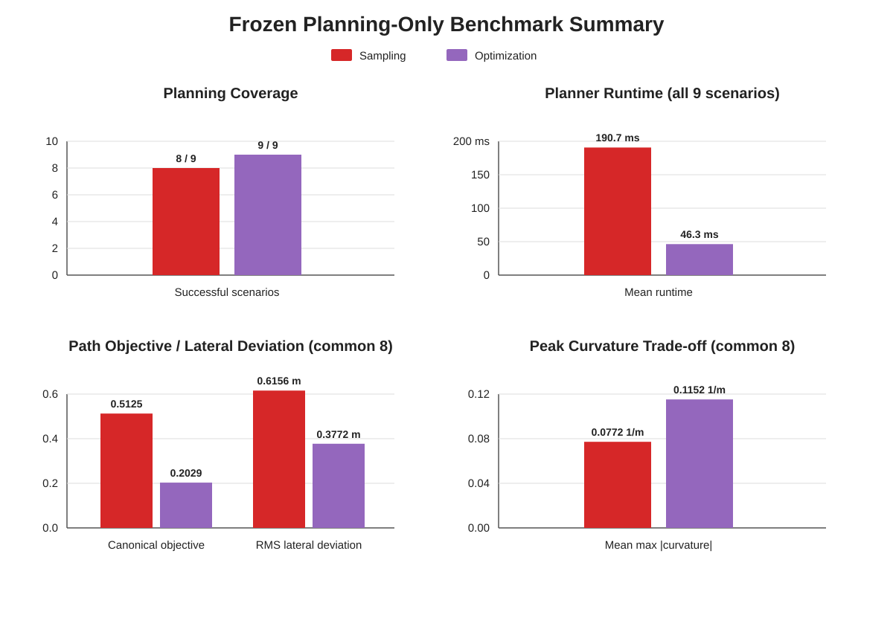
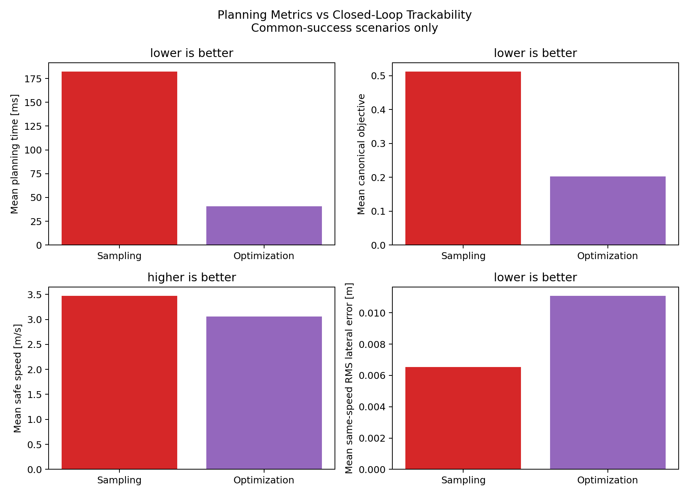
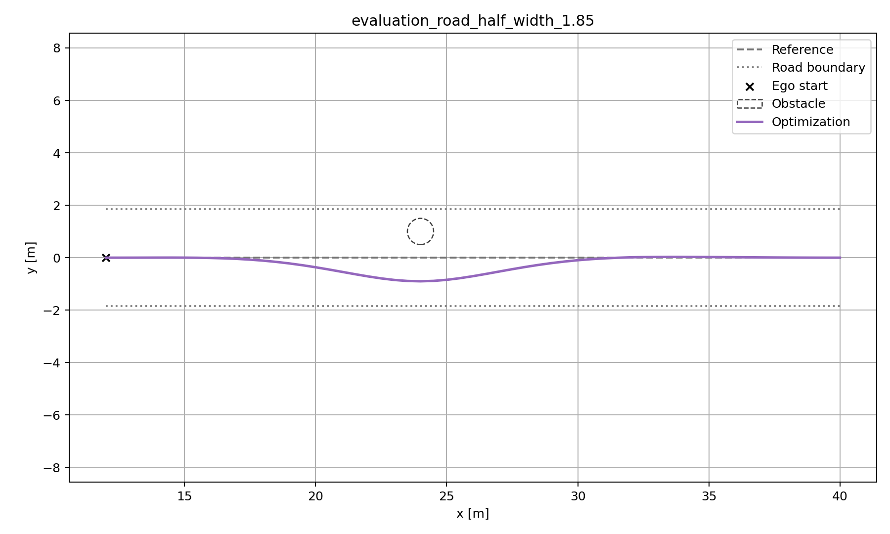

# Hybrid Autonomous Driving Planning & Control Portfolio

A modular autonomous-driving portfolio focused on **path planning, optimization, vehicle constraints, MPC integration, and reproducible evaluation**.

> The repository name retains the original VLM direction, but the current completed scope is classical **Planning & Control**. A VLM behavior layer remains an optional future extension and is not part of the current benchmark.

The project contains two connected planning approaches evaluated under the same vehicle and safety assumptions:

- **Sampling Planner** — Frenet candidate generation with quintic polynomials.
- **Optimization Planner** — explicit Frenet-state QP with piecewise-jerk dynamics, exact vehicle-footprint clearance, and sequential convex refinement.

Both planners feed the same curvature-aware MPC closed loop, allowing planning quality and controller trackability to be compared separately.

---

## Headline Results

### Planning-only benchmark

| Planner | Success | Mean runtime | Canonical objective* | RMS lateral deviation* |
| --- | ---: | ---: | ---: | ---: |
| Sampling | 8 / 9 | 190.7 ms | 0.5125 | 0.6156 m |
| Redesigned Optimization | **9 / 9** | **46.3 ms** | **0.2029** | **0.3772 m** |

\* Objective and lateral-deviation averages use the 8 scenarios solved by both planners.

Optimization also has the lower RMS curvature-rate average, while Sampling retains lower mean peak curvature and a larger worst-case clearance margin in the current suite.

> **Planning conclusion:** the current Optimization Planner is stronger on coverage, canonical objective, and computation time; Sampling remains competitive in geometric smoothness on several scenarios.



### Planning + Control benchmark

Every successfully planned path was also tracked successfully by the common curvature-aware MPC.

For the 8 scenarios solved by both planners:

| Metric | Sampling | Optimization |
| --- | ---: | ---: |
| Mean constant safe speed | **3.473 m/s** | 3.058 m/s |
| Mean system RMS lateral error | **0.00989 m** | 0.01317 m |
| Mean system RMS heading error | **0.00615 rad** | 0.00913 rad |
| Mean same-speed RMS lateral error | **0.00655 m** | 0.01109 m |
| Mean same-speed max feedback magnitude | **0.0273 rad** | 0.0710 rad |

> **Planning–Control conclusion:** Optimization is the stronger planner overall in the current frozen suite, but Sampling can produce paths that are easier for the current controller to track.



The difference is intentional to expose an important engineering point: **a lower planning-domain objective does not automatically imply lower steering demand or easier closed-loop tracking**.

Detailed interpretation: [`docs/final_planning_control_findings.md`](docs/final_planning_control_findings.md).

---

## System Architecture

```text
Scenario / Fixed Behavior Intent
            ↓
      Reference Line
            ↓
     Cartesian ↔ Frenet
            ↓
   ┌────────┴─────────┐
   │                  │
Sampling Planner   Optimization Planner
   │                  │
   └────────┬─────────┘
            ↓
 FrenetTrajectory + Cartesian Path
            ↓
 Common Physical Validation
            ↓
 Constant Safe-Speed Interface
            ↓
      Curvature-aware MPC
            ↓
      Steering Command
            ↓
    Kinematic Bicycle Model
            ↓
 Closed-loop Tracking Metrics
```

The same controller, vehicle parameters, and final physical acceptance definitions are used for both planner outputs.

---

## Main Engineering Story

The most important redesign started when planning constraints were aligned with downstream vehicle/control capability.

The configured vehicle uses:

```text
wheelbase L        = 2.7 m
max steering angle = 0.5 rad
```

Using the kinematic bicycle relation:

```text
kappa_max = tan(delta_max) / L ≈ 0.202334 1/m
```

Once the planner was judged against this vehicle-derived curvature limit, the earlier Optimization formulation exposed weaknesses in close-obstacle cases.

The original optimizer used:

- an `l`-only decision vector;
- finite-difference reconstruction of `l'`, `l''`, and `l'''`;
- initial derivative constraints imposed indirectly through early lateral samples;
- an inflated rectangular Frenet obstacle corridor.

Two structural limitations became important:

1. the finite-difference initial constraints could over-couple early lateral samples and delay useful lateral motion;
2. the rectangular corridor did not represent heading-dependent clearance of the rotated vehicle footprint accurately enough.

The production optimizer was therefore redesigned rather than tuned around these symptoms.

---

## Sampling Planner

The Sampling Planner generates a discrete family of smooth Frenet trajectories with quintic polynomials.

For the frozen obstacle-bypass family:

```text
9 lateral positions × 5 bypass lengths = 45 candidates
```

Each candidate is converted to Cartesian geometry and evaluated with the common physical validator before the best feasible candidate is selected.

### Why keep Sampling

- simple and interpretable candidate generation;
- smooth boundary-state behavior from quintic trajectories;
- easy candidate-by-candidate failure diagnosis;
- low peak curvature in several benchmark scenarios.

### Main limitation

Sampling only searches the predefined candidate family. A feasible continuous solution can exist between discrete candidates.

That limitation appears in:

```text
evaluation_road_half_width_1.85
```

where the frozen Sampling set fails while the Optimization Planner succeeds.

---

## Redesigned Optimization Planner

The current optimizer uses the explicit Frenet state:

```text
x = [l, l', l'']
```

instead of optimizing only lateral position and reconstructing all derivatives afterward.

### 1. Explicit state + piecewise-jerk dynamics

Within each spatial segment, lateral jerk is treated as piecewise constant:

```text
j_i = (l''_{i+1} - l''_i) / delta_s
```

This gives linear state-transition constraints suitable for QP optimization while allowing the true initial Frenet state to be imposed directly.

A matched development ablation supported the redesign rationale: explicit states removed the artificial early-knot coupling of the previous `l`-only formulation and enabled earlier, lower-cost lateral motion in feasible cases. However, obstacle regressions remained when the old rectangular corridor was retained, showing that the state/dynamics change alone was not sufficient.

### 2. Vehicle-derived curvature handling

The QP uses a convex local curvature approximation internally, while final acceptance uses reconstructed Cartesian path curvature against the vehicle-derived limit:

```text
|kappa| <= 0.202334 1/m
```

An OSQP solution is therefore not considered physically valid until the reconstructed path passes the shared validator.

### 3. Exact footprint clearance + SCP

Rotated vehicle-footprint clearance is nonlinear in the Frenet state, so the planner uses sequential convex programming:

```text
seed QP
   ↓
Cartesian reconstruction
   ↓
exact rotated-footprint clearance
   ↓
numerical clearance gradient
   ↓
linearized clearance constraint
   ↓
trust-region QP
   ↓
exact revalidation
```

This preserves a QP-based solve while refining the path against the same physical geometry used by the final validator.

### Computational trade-off

| Optimization version | Main formulation | Mean runtime |
| --- | --- | ---: |
| Original | `l`-only + finite differences + convex corridor | ~7.6 ms |
| Redesigned | explicit state + exact footprint evaluation + sequential QP refinement | ~46.3 ms |

The redesign is more expensive than the original optimizer, but remains about **4× faster** than the frozen Sampling benchmark on mean runtime.

---

## Control Integration

The controller stack uses:

- curvature feedforward;
- lateral MPC based on a linearized kinematic bicycle model;
- steering-angle and steering-rate constraints;
- OSQP-based QP solution;
- a constant-safe-speed interface derived from path steering demand.

The planner objective mainly penalizes Frenet-domain quantities such as:

```text
l, l', l'', l'''
```

The controller responds to quantities such as:

```text
Cartesian curvature
steering angle
steering rate
lateral tracking error
heading tracking error
feedback correction
```

These are not equivalent, especially on curved reference lines. This explains why a path with lower canonical planning cost can still require more steering effort or produce larger closed-loop error.

Two representative examples:

- `evaluation_obstacle_longitudinal_19.00`: Optimization is both planning-efficient and more controller-friendly.
- `evaluation_curved_obstacle`: Sampling is more controller-friendly despite a higher canonical planning objective.

---

## Common Physical Acceptance

Both planners are judged with the same final acceptance contract.

### Curvature

Returned Cartesian path curvature must remain within the vehicle-derived curvature limit.

### Obstacle clearance

At each returned pose, the rotated vehicle rectangle is checked against circular obstacle geometry:

```text
clearance > 0.5 m
```

This is exact for the implemented rectangle-circle geometry **at the sampled poses**; continuous swept-volume checking between knots is not yet implemented.

### Road boundary

The current road-boundary validator uses the shared Frenet-width contract:

```text
l - vehicle_half_width >= road_min_l
l + vehicle_half_width <= road_max_l
```

Exact rotated-corner road containment remains future work.

---

## Representative Planning Cases

### Close obstacle at 19 m

```text
evaluation_obstacle_longitudinal_19.00
```

| Metric | Sampling | Optimization |
| --- | ---: | ---: |
| Max curvature | 0.1522 1/m | **0.1263 1/m** |
| Minimum clearance | **0.5991 m** | 0.50085 m |
| Canonical objective | 0.4522 | **0.1711** |


### Narrow road

```text
evaluation_road_half_width_1.85
```

- Sampling: **FAIL**
- Optimization: **PASS**

The frozen Sampling candidate set is intentionally not retuned against this evaluation result.



---

## Evaluation Discipline

The current nine-scenario suite is treated as a **frozen evaluation suite**, not as a pristine unseen held-out set, because it was previously inspected during development and diagnosis.

Planner/controller parameters are not tuned from the frozen final results.

Development-only regression remains separate from final evaluation.

Current Optimization development regression:

- required development/tuning scenarios: **7 / 7 PASS**
- stress scenarios: **19 total**
- production-validation successes: **16**
- explicit infeasible / capability-boundary cases: **3**
- ordinary validation failures: **0**

---

## Project Outputs

Planner-only results:

```text
outputs/final_evaluation/
├── figures/
├── final_planner_evaluation.csv
└── final_planner_evaluation_summary.json
```

Planning + Control results:

```text
outputs/final_planning_control/
```

Planner scripts are grouped by purpose:

```text
scripts/planning/
├── validation/    # regression and component checks
├── development/   # tuning, diagnostics, studies
└── evaluation/    # frozen/final evaluation and figures
```

See [`scripts/planning/README.md`](scripts/planning/README.md) for the main entry points.

---

## Environment and Main Commands

Primary implementation:

- Python 3.10
- NumPy
- SciPy
- OSQP
- Matplotlib

Setup:

```bash
python -m venv .venv
pip install -r requirements.txt
```

Windows PowerShell:

```powershell
.venv\Scripts\Activate.ps1
```

Development-only Optimization regression:

```bash
python -m scripts.planning.validation.validate_planner_redesign_development
```

Build the planner summary figure from the frozen CSV:

```bash
python -m scripts.planning.evaluation.build_planner_summary_figure
```

Rebuild fixed-color planner scenario figures from the current frozen scenario suite:

```bash
python -m scripts.planning.evaluation.build_planner_scenario_figures
```

Run the final Planning + Control benchmark and build its figures:

```bash
python -m scripts.mpc.run_final_planning_control_benchmark
python -m scripts.mpc.build_final_planning_control_figures
```

The frozen evaluation suite should be used for evaluation, not as a tuning loop.

---

## Known Limitations and Next Directions

| Current limitation | Possible next step |
| --- | --- |
| Sampling uses a fixed 45-candidate family | Adaptive / coarse-to-fine candidate generation |
| Optimization often uses clearance close to the hard minimum | Robustness buffers or clearance-aware soft costs in a new tuning cycle |
| Sequential exact-clearance refinement increases runtime | Warm starts, analytical gradients, active-constraint screening |
| Obstacle geometry is more exact than road-boundary geometry | Rotated-footprint road containment |
| Collision checking is sampled-pose only | Inter-knot / swept-volume checking or adaptive spatial sampling |
| Planner objective is not fully controller-aligned | Curvature-rate / steering-rate / controller-oriented planning terms |
| Vehicle/control model is kinematic | Actuator delay, tire dynamics, slope, and model-mismatch validation |

Longer-term extensions include dynamic obstacles and prediction, deterministic fallback logic, and an optional VLM-based high-level behavior layer.
