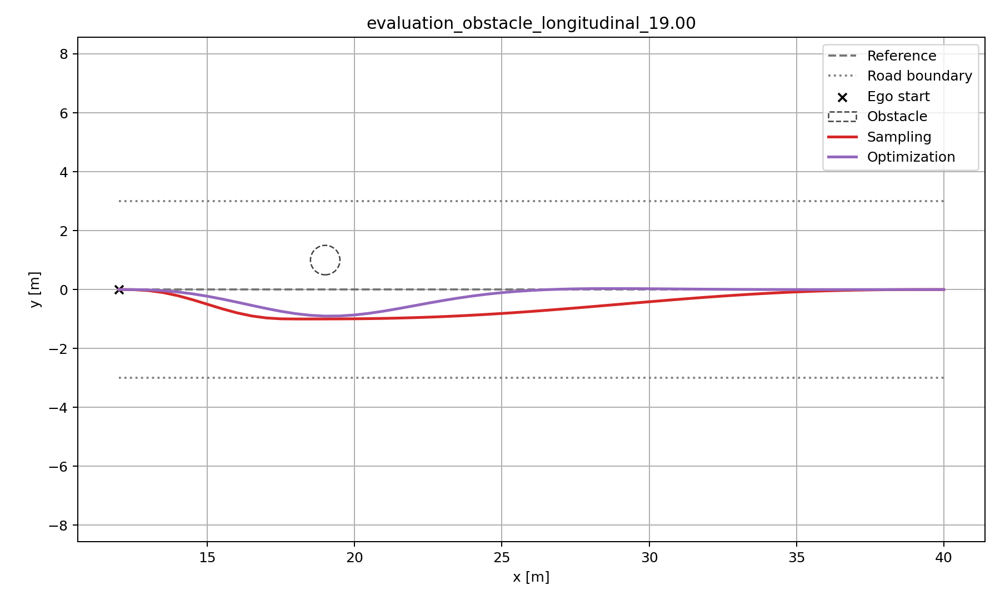
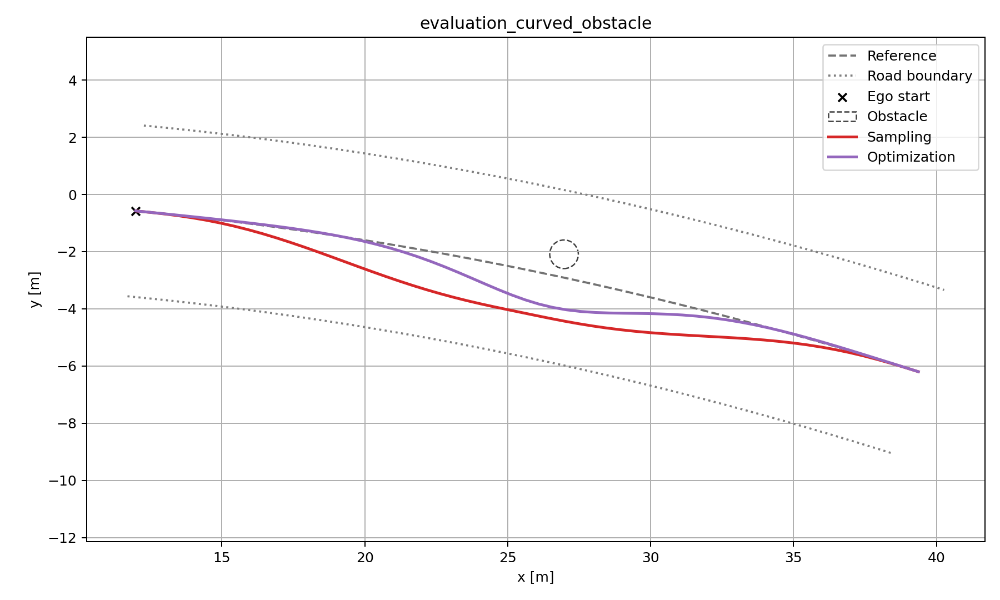

# VLM-Guided Hybrid Autonomous Driving Planner

A modular autonomous-driving **Planning & Control** portfolio focused on classical path planning, optimization, vehicle constraints, controller integration, and reproducible evaluation.

> **Current focus:** classical Planning & Control. The VLM behavior layer in the repository name is a planned optional extension and is not part of the current planner benchmark.

The repository currently contains two major completed tracks:

1. a closed-loop Planning & Control baseline with longitudinal PID/feedforward control, lateral MPC, and a kinematic bicycle model;
2. a Frenet path-planning benchmark comparing a Sampling Planner with a redesigned QP Optimization Planner under shared vehicle and safety constraints.

The next step is to connect the completed path planners to a curvature-aware MPC and evaluate both planners through the same closed-loop controller.

---

## Current Status

### Planning

- Smooth spline Reference Line with yaw, curvature, and curvature derivative
- Cartesian ↔ Frenet conversion
- Sampling-based Frenet path planner
- Optimization-based Frenet path planner
- Static-obstacle avoidance
- Vehicle-footprint obstacle clearance
- Vehicle-derived curvature limit
- Common physical acceptance checks
- Unified Sampling-vs-Optimization benchmark
- Development regression and stress-envelope validation
- Frozen nine-scenario evaluation suite

### Control

- Longitudinal feedforward + PID feedback
- Lateral MPC based on a linearized kinematic bicycle model
- Steering-angle and steering-rate constraints
- OSQP-based QP solve
- Closed-loop simulation with a kinematic bicycle vehicle model
- Baseline MPC calibration and validation

### Current headline result

| Planner | Evaluation success | Mean runtime |
| --- | ---: | ---: |
| Sampling | 8 / 9 | 190.7 ms |
| Redesigned Optimization | **9 / 9** | **46.3 ms** |

The Optimization Planner is about **4× faster** on mean runtime in the current frozen evaluation suite while solving the narrow-road case that is outside the frozen Sampling candidate set.

---

## System Architecture

The project currently has a completed control baseline and a completed path-planning benchmark. Their full closed-loop integration is the next stage.

### Path-planning benchmark

```text
Scenario / Fixed Behavior Intent
            ↓
      Reference Line
            ↓
     Cartesian ↔ Frenet
            ↓
   ┌────────┴─────────┐
   │                  │
Sampling Planner   Optimization Planner
   │                  │
   └────────┬─────────┘
            ↓
 FrenetTrajectory + Cartesian Path
            ↓
  Common Physical Validation
            ↓
   Metrics / Figures / Benchmark
```

### Existing closed-loop control baseline

```text
Scenario
   ↓
Rule-based Behavior Planner
   ↓
Reference Trajectory Generator
   ↓
┌─────────────────────┐
│                     │
Speed reference   Lateral / heading error
│                     │
Feedforward + PID     MPC
│                     │
Acceleration        Steering
└──────────┬──────────┘
           ↓
    Kinematic Bicycle Model
           ↓
       Vehicle State
           └──────── feedback
```

### Next integration step

```text
Sampling / Optimization Path
            ↓
      Curvature-aware MPC
            ↓
      Steering command
            ↓
    Kinematic Bicycle Model
            ↓
     Closed-loop comparison
```

---

## The Main Engineering Story: Planning–Control Consistency

The most important planner redesign in this project started while preparing the path planner for downstream MPC tracking.

The earlier benchmark used a permissive curvature acceptance limit of approximately:

```text
kappa_max = 1.0 1/m
```

But the configured vehicle has:

```text
wheelbase L        = 2.7 m
max steering angle = 0.5 rad
```

Using bicycle-model steering geometry:

```text
kappa_max = tan(delta_max) / L
          = tan(0.5) / 2.7
          ≈ 0.202334 1/m
```

A planner path that is mathematically feasible but exceeds this limit is not physically consistent with the downstream vehicle/controller model.

After the common acceptance limit was aligned to the vehicle-derived value, the original Optimization Planner exposed structural weaknesses in close-obstacle cases. The key diagnostic observation was:

- Sampling could still produce a path inside the same realistic curvature limit;
- the old Optimization formulation became infeasible or produced excessive Cartesian curvature.

That suggested a **formulation problem**, not simply an impossible scenario or a bad objective weight.

The old Optimization Planner used:

- an `l`-only optimization vector;
- finite-difference approximations for `l'`, `l''`, and `l'''`;
- initial derivative constraints imposed indirectly through early `l` samples;
- inflated rectangular Frenet obstacle corridors.

Two limitations became important:

1. finite-difference initial-state constraints could over-couple the first several lateral samples and delay useful lateral motion;
2. the rectangular Frenet obstacle corridor could not fully exploit heading-dependent vehicle-footprint clearance.

The planner was therefore redesigned instead of further tuned around these symptoms.

See [`docs/planner_benchmark_summary.md`](docs/planner_benchmark_summary.md) for the detailed benchmark history and analysis.

---

## Sampling Planner

The Sampling Planner generates a discrete family of smooth Frenet candidates using quintic polynomials.

The frozen bypass search space uses:

- lateral bypass positions from `-2.0 m` to `+2.0 m`;
- five bypass lengths: `6, 10, 14, 18, 22 m`;
- common planning horizon and terminal return target;
- Cartesian reconstruction followed by shared physical validation.

For the main obstacle-avoidance family this gives:

```text
9 lateral positions × 5 bypass lengths = 45 candidates
```

### Strengths

- simple and interpretable candidate generation;
- smooth quintic trajectory family;
- strong terminal return behavior;
- low mean curvature in the current benchmark;
- easy failure diagnosis because each candidate can be inspected independently.

### Structural limitation

Sampling only searches its predefined candidate family. If the physical feasible region lies between sampled candidates, the planner can fail even though a continuous feasible path exists.

That limitation is visible in the final `road_half_width_1.85` scenario.

---

## Redesigned Optimization Planner

The current Optimization Planner uses the explicit Frenet state:

```text
x = [l, l', l'']
```

rather than optimizing only lateral position and reconstructing every derivative afterward.

### Piecewise-constant-jerk dynamics

Within each spatial interval, Frenet jerk is assumed constant:

```text
j_i = (l''_{i+1} - l''_i) / delta_s
```

This gives linear state-transition constraints between `l`, `l'`, and `l''`, while allowing the initial Frenet state to be imposed directly.

### Vehicle-derived curvature handling

The QP uses a local curvature proxy for convex constraints, while final acceptance uses the reconstructed Cartesian path curvature against the vehicle-derived limit:

```text
kappa_max ≈ 0.202334 1/m
```

The optimizer is therefore not trusted solely because OSQP returns a solution.

### Heading-aware obstacle handling

Obstacle clearance depends on both lateral position and heading. The redesigned planner uses heading-aware nominal constraints and exact sampled-pose clearance of the rotated vehicle rectangle against circular obstacles.

Because exact footprint clearance is nonlinear, the planner uses **sequential convex refinement**:

```text
nominal QP
   ↓
Cartesian reconstruction
   ↓
exact sampled-pose clearance
   ↓
numerical clearance gradient
   ↓
linearized clearance constraint
   ↓
trust-region QP
   ↓
exact revalidation
```

Current refinement settings include:

- maximum iterations: `6`
- clearance numerical buffer: `0.001 m`
- trust region in `l`: `0.15 m`
- trust region in `l'`: `0.08`
- numerical clearance-gradient epsilon: `1e-4`

This retains structured convex QP subproblems while allowing orientation-dependent obstacle geometry to affect the solution.

### Computational cost of the redesign

The added physical consistency is not free. In the original frozen benchmark, the simpler `l`-only convex-corridor Optimization Planner averaged approximately **7.6 ms** per complete planner call. After the explicit-state and sequential-convex redesign, the current Optimization Planner averages approximately **46.3 ms**.

| Optimization version | Main formulation | Mean planner runtime |
| --- | --- | ---: |
| Original | `l`-only + finite differences + convex corridor | ~7.6 ms |
| Redesigned | explicit `[l, l', l'']` + exact footprint evaluation + sequential QP refinement | ~46.3 ms |

The redesign therefore increases the historical mean Optimization runtime by roughly **6.1×**. The increase comes from repeated QP solves, Cartesian reconstruction, exact footprint evaluation, numerical clearance gradients, and trust-region refinement.

This is a deliberate engineering trade-off: the planner spends substantially more computation to obtain vehicle-consistent curvature handling and orientation-aware obstacle feasibility. Even after this increase, it remains about **4.1× faster** than the frozen Sampling Planner benchmark at approximately `190.7 ms` mean runtime.

---

## Common Physical Acceptance Contract

Both planners are judged using the same final acceptance definitions.

### Cartesian curvature

Returned Cartesian path curvature must remain inside the vehicle-derived curvature limit.

### Obstacle clearance

At every returned sampled pose, the rotated vehicle rectangle is checked against the circular obstacle geometry.

The configured requirement is strict:

```text
clearance > 0.5 m
```

This is exact for the implemented rectangle-circle geometry **at returned poses**. It is not continuous inter-knot collision checking.

### Road boundary

The production road-boundary validator currently uses a shared Frenet lateral-width contract:

```text
l - vehicle_half_width >= road_min_l
l + vehicle_half_width <= road_max_l
```

It does **not** enforce full rotated-corner road containment.

A separate development diagnostic evaluates rotated footprint corners and reports warnings, but those warnings are not part of the current production acceptance criterion.

The accurate scope statement is therefore:

> **Exact sampled-pose obstacle-clearance and Cartesian-curvature validation, with Frenet-based road-boundary validation.**

---

## Development Regression

The redesigned Optimization Planner has a dedicated development-only regression script:

```bash
python -m scripts.planning.validate_planner_redesign_development
```

It does not build or execute the final evaluation scenarios.

Current development result:

- required development/tuning scenarios: **7 / 7 PASS**
- stress scenarios: **19 total**
- production-validation successes: **16**
- explicit infeasible / capability-boundary cases: **3**
- ordinary validation failures: **0**

Near-boundary cases are reported diagnostically instead of being automatically tuned away.

---

## Frozen Evaluation Results

The same nine scenario geometries are retained before and after the Optimization redesign.

Because some evaluation cases were inspected while diagnosing the original planner limitation, this set is described as a **frozen evaluation suite**, not as a pristine unseen test set.

After the redesign, production planner logic was frozen and the nine-scenario suite was rerun without retuning Sampling to its observed narrow-road failure.

### Success rate

| Planner | Success | Rate |
| --- | ---: | ---: |
| Sampling | 8 / 9 | 88.89% |
| Redesigned Optimization | **9 / 9** | **100.00%** |

Sampling fails only:

```text
evaluation_road_half_width_1.85
```

Its 45 candidates have overlapping curvature, clearance, and road-boundary failure categories. The redesigned Optimization Planner succeeds in the same narrow feasible region using continuous decision freedom over `l`, `l'`, and `l''`.

### Common-success metrics

The following path-quality metrics use only the 8 scenarios solved by both planners.

| Metric | Sampling | Optimization |
| --- | ---: | ---: |
| Canonical objective | 0.5125 | **0.2029** |
| RMS lateral deviation [m] | 0.6156 | **0.3772** |
| Worst obstacle clearance [m] | **0.5544** | 0.500096 |
| Mean max curvature [1/m] | **0.0772** | 0.1152 |
| RMS curvature rate [1/m²] | 0.0263 | **0.0224** |

The result is a trade-off rather than universal dominance:

- Optimization reaches a lower canonical objective and lower RMS lateral deviation;
- Sampling keeps larger obstacle-clearance margin and lower mean peak curvature;
- Optimization often uses the feasible space more aggressively and can operate close to the hard clearance boundary.

### Runtime

| Planner | Mean [ms] | Median [ms] | Min [ms] | Max [ms] |
| --- | ---: | ---: | ---: | ---: |
| Sampling | 190.665 | 188.397 | 181.477 | 220.490 |
| Optimization | **46.279** | **53.753** | **12.502** | **62.700** |

The redesigned Optimization Planner is approximately **4.1× faster** on mean runtime in this benchmark. Relative to the original Optimization formulation's historical mean of approximately **7.6 ms**, the redesign is roughly **6.1× slower**, reflecting the added sequential refinement and exact geometry work described above.

---

## Case Study: Close Obstacle at 19 m

This scenario is the clearest example of the Planning–Control consistency issue.

```text
evaluation_obstacle_longitudinal_19.00
```

The earlier Optimization result had approximately:

```text
max Cartesian curvature ≈ 0.654 1/m
minimum clearance       ≈ 1.092 m
```

The path looked acceptable under the earlier permissive benchmark but was far outside the actual vehicle steering-derived curvature limit.

Under the corrected physical limit:

### Sampling

```text
max curvature     ≈ 0.1522 1/m
minimum clearance ≈ 0.5991 m
```

### Redesigned Optimization

```text
max curvature     ≈ 0.1263 1/m
minimum clearance ≈ 0.50085 m
canonical objective ≈ 0.1711
```

Both are inside the vehicle curvature limit, showing that the scenario itself is physically reachable under the project model and that the original Optimization limitation was structural.



---

## Case Study: Narrow Road

The fixed evaluation suite already contained:

```text
evaluation_road_half_width_1.85
```

Before the Optimization redesign, both planners failed this case.

After the redesign:

- Sampling: **FAIL**
- Optimization: **PASS**

The Sampling candidate set is intentionally left unchanged after observing this result rather than being tuned against the evaluation suite.


---

## Curved Reference-Line Evaluation

The evaluation suite also includes a different curved Reference Line and a curved-reference obstacle case.

Both planners solve:

- `evaluation_curved_nominal`
- `evaluation_curved_obstacle`



---

## Phase 1 Control Baseline

Before the current path-planning benchmark, the repository established a closed-loop control baseline.

### Longitudinal control

```text
a_cmd = a_ref + PID(v_ref - v)
```

The feedforward term handles the ideal reference acceleration and PID feedback corrects speed error. Output acceleration is constrained by configured acceleration/deceleration limits.

### Lateral MPC

The lateral controller uses lateral and heading error with a linearized kinematic bicycle model and solves a finite-horizon QP with OSQP.

Implemented features include:

- receding-horizon steering optimization;
- steering-angle constraints;
- steering-rate constraints;
- lateral/heading recovery validation;
- baseline calibration across multiple conditions.

### Closed-loop baseline scenarios

- KEEP_LANE
- SLOW_DOWN
- STOP

These scenarios use the earlier simple reference-trajectory generator and are intentionally kept separate from the newer Sampling/Optimization path-planner benchmark until the next integration stage.

---

## Project Structure

```text
vlm-hybrid-pnc/
├── docs/
│   ├── planner_benchmark_summary.md
│   ├── roadmap.md
│   └── ultra_short_notes/
├── outputs/
│   └── final_evaluation/
│       ├── figures/
│       ├── final_planner_evaluation.csv
│       └── final_planner_evaluation_summary.json
├── results/                  # Phase 1 closed-loop figures
├── scripts/
│   ├── mpc/                  # MPC calibration / validation
│   ├── planning/             # planner validation / benchmark / evaluation
│   └── run_pnc_closed_loop.py
└── src/
    ├── behavior/
    ├── benchmark/
    ├── common/
    ├── config/
    ├── control/
    ├── planning/
    ├── scenario/
    └── vehicle/
```

---

## Environment

Primary implementation:

- Python 3.10
- NumPy
- SciPy
- OSQP
- Matplotlib

Install dependencies:

```bash
python -m venv .venv
pip install -r requirements.txt
```

Activate the environment on Windows PowerShell:

```powershell
.venv\Scripts\Activate.ps1
```

or on Linux/macOS:

```bash
source .venv/bin/activate
```

---

## Useful Commands

Run the development-only Optimization regression:

```bash
python -m scripts.planning.validate_planner_redesign_development
```

Show the canonical planner benchmark:

```bash
python -m scripts.planning.show_canonical_benchmark
```

Validate the lateral MPC baseline:

```bash
python -m scripts.mpc.validate_lateral_mpc
```

Run the original closed-loop Planning & Control baseline:

```bash
python -m scripts.run_pnc_closed_loop
```

Reproduce the frozen planner evaluation artifacts:

```bash
python -m scripts.planning.run_final_planner_evaluation
```

The frozen evaluation suite should be treated as evaluation, not as a tuning loop.

---

## Known Limitations

The project intentionally keeps several limitations explicit:

- obstacle clearance is exact only at returned sampled poses, not continuously between knots;
- production road-boundary validation uses Frenet vehicle width rather than exact rotated-footprint containment;
- the Optimization QP uses a local curvature proxy internally and relies on exact Cartesian curvature post-validation;
- the current redesigned Optimization flow is focused on the static-obstacle benchmark scope rather than a production multi-object dynamic planner;
- path planning and the curvature-aware MPC are not yet connected in the final common closed loop;
- the vehicle model is kinematic and does not include actuator delay, tire dynamics, road slope, or model mismatch;
- dynamic obstacles and prediction are future work;
- VLM behavior decision making is future work and is not used to generate low-level control commands.

---

## Engineering Discussion and Improvement Directions

The benchmark is intended not only to report pass/fail results, but also to expose where each formulation is strong, where the current model is approximate, and what should be improved next.

| Observation | Interpretation | Improvement direction |
| --- | --- | --- |
| Sampling fails the `1.85 m` half-width case while Optimization passes | The frozen 45-candidate library does not cover this narrow feasible region under the current acceptance contract; this is not proof that Sampling as a method is inherently infeasible | Adaptive or denser candidate generation, or a coarse-to-fine Sampling strategy, evaluated on new development cases rather than tuned against the frozen evaluation result |
| Optimization's worst successful clearance is only slightly above `0.5 m` | A constrained optimizer can use the available feasible boundary aggressively when additional clearance is not rewarded by the objective | Add a robustness buffer or clearance soft cost, then retune and evaluate the safety-margin / path-quality trade-off |
| Optimization runtime increased from ~`7.6 ms` to ~`46.3 ms` after redesign | Explicit physical state, repeated exact geometry checks, numerical gradients, and sequential QP refinement improve consistency at a substantial computational cost | Investigate warm starts, analytical clearance gradients, active-constraint screening, adaptive refinement, and earlier convergence termination |
| Obstacle clearance uses rotated vehicle geometry but road-boundary acceptance still uses Frenet width | The current physical model is not equally exact for obstacle and road geometry; rotated-corner diagnostics can expose optimistic road-boundary acceptance | Promote rotated-footprint road containment from diagnostic to production constraint, followed by a new regression cycle |
| Collision checking is exact only at returned sampled poses | A safe pair of adjacent knots does not mathematically guarantee continuous clearance between them | Add inter-knot / swept-volume collision checking or adaptive spatial sampling around near-boundary regions |
| Planner feasibility is currently evaluated mainly open-loop | A geometrically valid path can still be difficult for a real controller to track under steering-rate, model, or actuator limits | Run Sampling and Optimization through the same curvature-aware MPC and compare closed-loop tracking, steering, constraint utilization, and failures |

The highest-priority improvement is the last item: **Planning–Control closed-loop validation**. It directly tests the engineering question that originally triggered the Optimization redesign — whether a path accepted by Planning remains trackable under the same vehicle assumptions used by Control.

The other items are deliberately kept as improvement directions rather than silently changed after observing the current evaluation results. Any change to clearance margin, candidate density, road geometry, or sequential-refinement behavior would require a new development/tuning cycle and a clearly versioned evaluation protocol.

---

## Next Step

The immediate next milestone is **curvature-aware Planning & Control integration**:

1. feed the Sampling and Optimization planned paths into the same controller;
2. add curvature-based steering feedforward to the lateral MPC;
3. keep MPC feedback correction and steering constraints;
4. run both planners through the same closed-loop vehicle model;
5. compare tracking error, steering behavior, planner quality, runtime, and failure cases.

Longer-term optional extensions include dynamic scenarios, C++ migration, deterministic safety/fallback logic, ROS 2 integration, and a VLM-based high-level behavior layer.

See [`docs/roadmap.md`](docs/roadmap.md) for the detailed development history and roadmap.