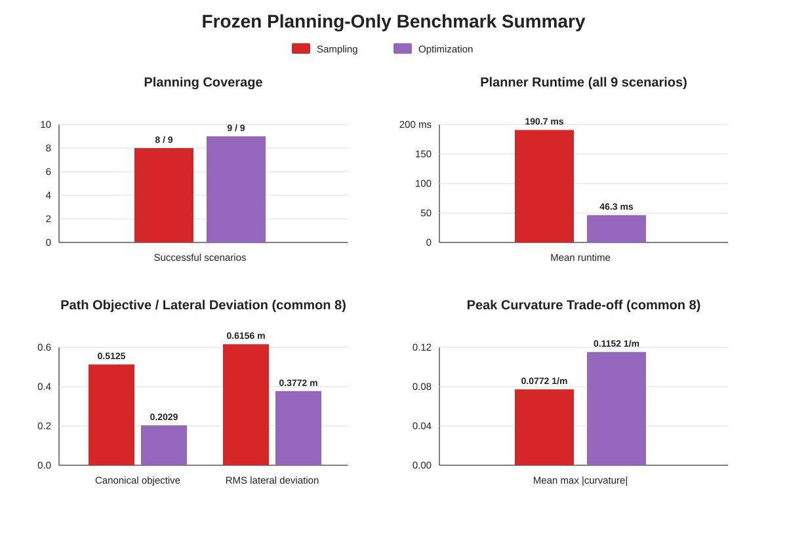
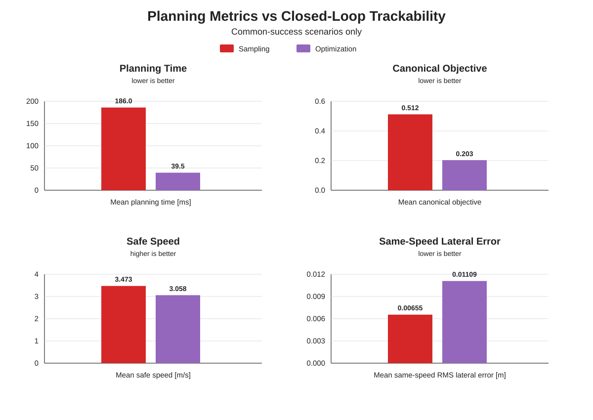
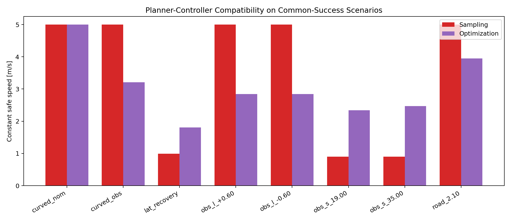
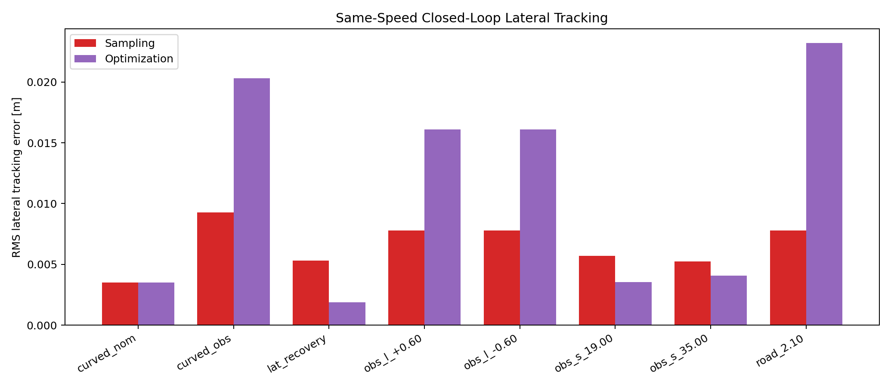

# Final Planning & Control Benchmark Findings

## Scope

This benchmark evaluates the frozen 9-scenario evaluation suite using the current production Sampling Planner, Optimization Planner, constant-safe-speed interface, and common curvature-aware MPC.

The suite has been inspected previously during diagnosis, so it is described as a **frozen evaluation suite**, not as a pristine unseen held-out set.

No planner or controller parameters are tuned from these final results.

Longitudinal speed-transition dynamics remain outside the current scope. Each closed-loop run starts directly at its requested constant speed.

For all portfolio figures, the planner color convention is fixed by planner identity rather than plotting order:

- **Sampling = red**
- **Optimization = purple**

This avoids misleading color changes when one planner has no valid result in a scenario.

## Planning-only result

The planner-only benchmark and the closed-loop benchmark answer different questions and should be read separately.

| Planning metric | Sampling | Optimization |
| --- | ---: | ---: |
| Planner success | 8 / 9 | **9 / 9** |
| Mean planning time, all 9 scenarios | 190.7 ms | **46.3 ms** |
| Mean canonical objective, common 8 scenarios | 0.5125 | **0.2029** |
| Mean RMS lateral deviation, common 8 scenarios | 0.6156 m | **0.3772 m** |
| Mean max absolute Cartesian curvature, common 8 scenarios | **0.0772 1/m** | 0.1152 1/m |

The planner-only conclusion is therefore:

> **The current Optimization Planner is the stronger planner on coverage, canonical objective, and computation time, while Sampling retains an advantage in mean peak curvature and clearance margin.**

The canonical objective is useful for evaluating the path-shape terms that it explicitly contains, but it is not a complete controller-trackability metric.

## Final Planning & Control success results

| Metric | Sampling | Optimization |
| --- | ---: | ---: |
| Planner success | 8 / 9 | 9 / 9 |
| Closed-loop success after planner success | 8 / 8 | 9 / 9 |
| Planner failure | `evaluation_road_half_width_1.85` | none |

All successfully planned paths were tracked successfully by the common curvature-aware MPC.

## Common-success closed-loop comparison

For a fair direct comparison, path and tracking averages below use only the 8 scenarios where both planners succeeded.

| Metric, common 8 scenarios | Sampling | Optimization |
| --- | ---: | ---: |
| Mean constant safe speed | **3.473 m/s** | 3.058 m/s |
| Mean system RMS lateral error | **0.00989 m** | 0.01317 m |
| Mean system RMS heading error | **0.00615 rad** | 0.00913 rad |
| Mean same-speed RMS lateral error | **0.00655 m** | 0.01109 m |
| Mean same-speed RMS heading error | **0.00451 rad** | 0.00793 rad |
| Mean same-speed max feedback magnitude | **0.0273 rad** | 0.0710 rad |
| Mean single-run planning time | 186.0 ms | **39.5 ms** |
| Mean canonical matched objective | 0.512 | **0.203** |

Single-run planning time in this table is reported as a directional comparison only; repeated runtime benchmarking is maintained separately.

## Why the ranking changes after control integration

The Optimization Planner improves planning feasibility and consistently reduces the canonical Frenet objective, but this does **not** imply universally better vehicle/controller trackability.

Across the 8 common-success scenarios:

- Optimization has the lower canonical objective in 7 scenarios, with 1 practical tie.
- Sampling has the higher safe speed in 4 scenarios.
- Optimization has the higher safe speed in 3 scenarios.
- 1 scenario is effectively tied.
- Sampling has the lower same-speed RMS lateral tracking error in 5 scenarios.
- Optimization has the lower same-speed RMS lateral tracking error in 3 scenarios.

The reason is objective alignment. The canonical planner objective penalizes Frenet quantities such as `l`, `l'`, `l''`, and `l'''`. The controller, however, is directly affected by Cartesian curvature distribution, steering-angle demand, steering-rate demand, lateral error, and heading error. On a curved reference line these controller-relevant quantities are nonlinear functions of the reference geometry and Frenet state.

Therefore the accurate interpretation is:

> **The planning objective correlates with geometric path quality, but it is not fully aligned with controller-oriented trackability metrics such as steering-rate demand, safe speed, and closed-loop tracking error.**

This is not a contradiction between the two benchmarks. They measure different layers:

- **Planning-only:** Optimization is stronger overall in the current frozen suite.
- **Planning + Control:** Sampling is more controller-friendly in several scenarios, although Optimization is better in others.

A concise portfolio summary is:

> **Optimization is the stronger planner, but Sampling can produce paths that are easier for the current controller to track.**

## Representative cases

### Early obstacle: Optimization advantage

In `evaluation_obstacle_longitudinal_19.00`:

- Sampling safe speed: `0.897 m/s`
- Optimization safe speed: `2.338 m/s`

At the same lower comparison speed, Optimization also produces lower tracking error and lower feedback effort.

This shows that the Optimization formulation can produce a substantially more controller-friendly path in some close-obstacle geometries.

### Curved obstacle: Sampling advantage

In `evaluation_curved_obstacle`:

- Sampling safe speed: `5.000 m/s`
- Optimization safe speed: `3.210 m/s`
- Sampling max absolute Cartesian curvature: `0.0516 1/m`
- Optimization max absolute Cartesian curvature: `0.1325 1/m`
- Sampling same-speed RMS lateral error: `0.00926 m`
- Optimization same-speed RMS lateral error: `0.02032 m`

The Optimization path has a substantially lower canonical Frenet objective, but the Sampling path is more benign in Cartesian curvature and closed-loop tracking.

## Steering feasibility and current limitation

The current spatial planners enforce steering-angle-equivalent curvature feasibility. Steering-rate trackability is handled downstream through the constant-safe-speed layer.

A development-only probe on the close-obstacle Sampling case found:

- total Sampling candidates: `45`
- physically feasible candidates: `1`
- candidates trackable at the `5 m/s` target under the configured steering-rate limit: `0`

This means the low safe speed in that case is not merely a candidate-selection problem. The current Sampling candidate family contains no target-speed-trackable solution under the present physical and steering-rate assumptions.

Addressing this would require planner-level steering-rate / curvature-rate-aware candidate generation or constraints. It is intentionally left as future work rather than added to the current production planner.

The configured `0.5 rad/s` steering-rate limit is treated as a baseline MPC/vehicle parameter, not as a measured physical actuator specification.

## Figure interpretation

The portfolio should show two complementary summary views:

1. **Planning-only summary** — success rate, planner runtime, canonical objective, and path geometry.
2. **Planning–Control bridge** — planner metrics alongside safe speed and closed-loop tracking metrics.

The bridge view is intentionally designed to make the objective-alignment gap visible rather than hiding it.

## Final interpretation

The two planners have complementary strengths:

- **Optimization Planner**: higher planning coverage, lower canonical objective, and lower planning computation time in the current implementation.
- **Sampling Planner**: in several scenarios, smoother Cartesian geometry and lower closed-loop tracking/control effort despite a higher canonical Frenet objective.

The final portfolio conclusion should therefore avoid claiming that either planner is universally superior. The useful result is the demonstrated interaction between planning formulation, Cartesian path geometry, actuator-compatible speed, and closed-loop control.
