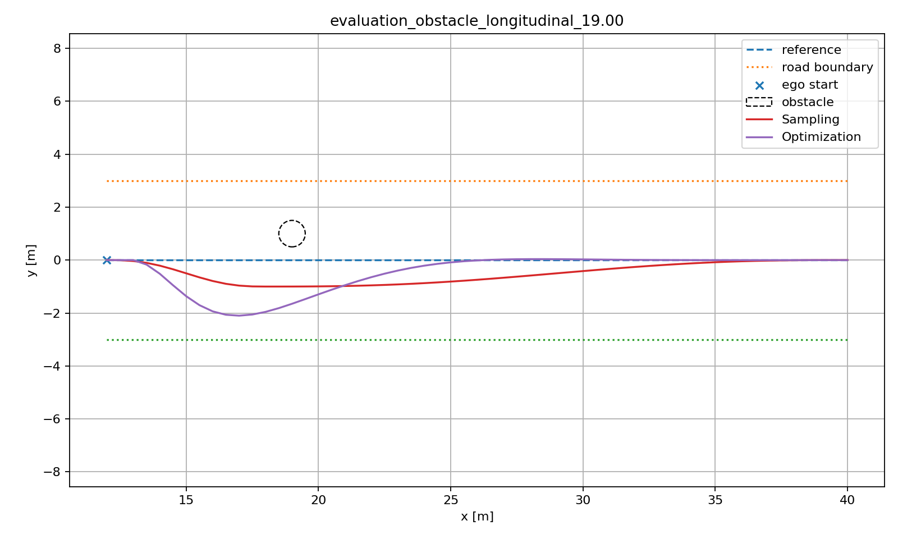
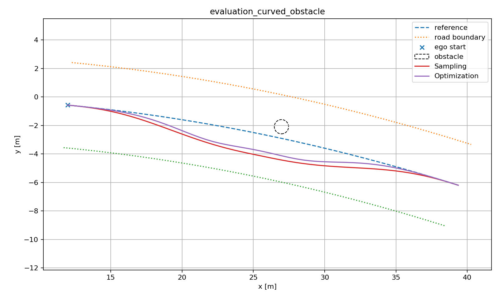

# Sampling vs Optimization Planner — Final Benchmark

## 1. Objective

This benchmark compares two lateral path-planning approaches under the same fixed behavior intent:

- Sampling-based Frenet planner
- Convex QP Optimization-based Frenet planner

Both planners solve the same high-level maneuver:

1. avoid a static obstacle when present;
2. remain within the drivable road boundary;
3. satisfy common physical constraints;
4. return toward the Reference Line by the end of the planning horizon.

The benchmark focuses on the algorithmic trade-off between discrete candidate search and continuous convex optimization rather than Behavior Planning.

---

## 2. Evaluation Methodology

Planner tuning was completed before the final evaluation.

The final tuned configurations were frozen at Git commit:

`b838308a16735ca37515890c1bbb0e8dc54369a6`

The final evaluation uses 9 held-out scenarios that were not used for parameter tuning.

The comparison protocol was fixed before executing the held-out set:

- success rate: evaluated over all 9 scenarios;
- path quality: compared only on scenarios where both planners succeed;
- smoothness: compared only on common-success scenarios;
- obstacle clearance: compared on common-success obstacle scenarios;
- runtime: measured over all held-out scenarios.

This prevents a planner with more failures from obtaining an artificially favorable mean path-quality score by being evaluated only on easier successful cases.

---

## 3. Frozen Planner Configurations

### Sampling Planner

The final Sampling search space contains:

- bypass lateral positions: `[-2.0, -1.5, ..., 1.5, 2.0] m`
- bypass lengths: `[6, 10, 14, 18, 22] m`
- strict terminal lateral target: `l = 0`
- strict terminal slope target: `l' = 0`
- resolution: `0.5 m`

This produces:

`9 lateral positions × 5 bypass lengths = 45 candidates`

The matched objective weights remain:

`(1, 1, 5, 20, 5, 5)`

for:

`l, l', l'', l''', terminal l, terminal l'`.

### Optimization Planner

The final Optimization configuration uses:

- resolution: `0.5 m`
- maximum `|l''|` proxy bound: `1.0`
- obstacle inflation safety margin: `0.05 m`
- corridor epsilon: `0.01 m`
- OSQP `eps_abs = eps_rel = 1e-6`

The internal matched objective weights are:

`(0.5, 1, 5, 20, 5, 5)`

The benchmark canonical evaluator remains independent from these planner-internal weights.

---

## 4. Held-out Success Rate

| Planner | Success | Rate |
| --- | ---: | ---: |
| Sampling | 8 / 9 | 88.89% |
| Optimization | 8 / 9 | 88.89% |

Both planners failed only:

`evaluation_road_half_width_1.85`

All other held-out scenarios were successfully solved by both planners, including:

- lateral recovery;
- mirrored obstacle positions;
- early and late obstacle positions;
- moderately narrow road;
- alternate curved Reference Line;
- curved Reference Line with obstacle.

The matching held-out success rate suggests that the tuned configurations generalized beyond the development/tuning scenario set rather than improving only the tuning cases.

---

## 5. Common-success Path Quality

The following metrics are averaged over the 8 scenarios successfully solved by both planners.

| Metric | Sampling | Optimization |
| --- | ---: | ---: |
| Canonical objective | **0.5125** | 0.6772 |
| Terminal lateral error [m] | **~0.0000** | 0.00439 |
| Terminal slope error | **0.00189** | 0.00833 |
| RMS lateral deviation [m] | 0.6156 | **0.6026** |
| Cartesian path length [m] | **28.129** | 28.264 |
| Mean obstacle clearance [m] | 0.6583 | **0.7048** |
| Worst obstacle clearance [m] | **0.5544** | 0.5118 |
| Mean max curvature [1/m] | **0.0772** | 0.1812 |
| RMS curvature [1/m] | **0.0338** | 0.0561 |
| RMS curvature rate [1/m²] | **0.0263** | 0.0503 |

The two planners therefore show a clear trade-off rather than one planner dominating every metric.

Optimization achieves slightly smaller RMS lateral deviation, while Sampling produces smoother paths on average and better terminal convergence.

---

## 6. Smoothness Comparison

Sampling achieved substantially lower curvature-related metrics:

- lower mean maximum absolute curvature;
- lower RMS curvature;
- lower RMS curvature rate.

This behavior is consistent with the structure of the Sampling Planner.

Each candidate is formed from smooth quintic polynomial segments, and the selected maneuver must belong to this predefined smooth trajectory family.

The Optimization Planner instead directly optimizes discrete lateral positions under finite-difference penalties and corridor constraints.

Although the QP penalizes `l''` and `l'''`, obstacle-corridor constraints can force relatively aggressive local lateral motion, particularly when the obstacle is close to the ego vehicle.

Therefore, continuous optimization does not automatically imply a smoother Cartesian trajectory.

---

## 7. Safety-margin Comparison

Optimization achieved a larger mean obstacle clearance:

- Sampling: `0.6583 m`
- Optimization: `0.7048 m`

However, its worst successful clearance was smaller:

- Sampling: `0.5544 m`
- Optimization: `0.5118 m`

The required minimum clearance is `0.5 m`.

Therefore, it would be misleading to conclude simply that Optimization is "safer."

A more accurate conclusion is:

> The Optimization Planner produced larger clearance on average, but some optimized paths operated closer to the hard clearance boundary.

This is consistent with a constrained optimization formulation that may use available feasible space more aggressively.

---

## 8. Early-obstacle Case Study

A particularly informative held-out case is:

`evaluation_obstacle_longitudinal_19.00`

The obstacle appears relatively close to the initial vehicle position.

### Sampling

- canonical objective: approximately `0.452`
- minimum clearance: approximately `0.599 m`
- maximum curvature: approximately `0.152 1/m`

### Optimization

- canonical objective: approximately `2.224`
- minimum clearance: approximately `1.092 m`
- maximum curvature: approximately `0.654 1/m`

The Optimization Planner remains physically feasible, but takes a significantly more aggressive avoidance trajectory.

This single difficult case also strongly affects its aggregate canonical-objective result.

When this case is excluded only for diagnostic interpretation — not for official benchmark scoring — the mean canonical objective over the remaining common-success cases is approximately:

- Sampling: `0.521`
- Optimization: `0.456`

This indicates that the aggregate Optimization objective is not uniformly worse across ordinary cases. Instead, its mean is strongly influenced by this near-field obstacle case.

---

## 9. Convex Corridor Approximation Trade-off

The Optimization Planner does not optimize collision avoidance directly against the original circular obstacle geometry.

Instead, the pipeline performs:

`obstacle geometry`
→ `Frenet projection`
→ `inflation`
→ `left/right convex lateral corridors`
→ `QP optimization`

This transformation makes the optimization problem convex and computationally efficient.

However, it also introduces an approximation.

For difficult near-field obstacles, the lateral corridor may impose a relatively rigid avoidance boundary over part of the horizon. The optimizer then minimizes its quadratic objective inside that feasible convex region, but the resulting maneuver can become more aggressive than a smooth sampled polynomial candidate.

This is the principal engineering trade-off observed in the final evaluation:

> Convexification enables extremely fast continuous optimization, but the quality of the final path is influenced by the geometry of the corridor approximation.

---

## 10. Sampling-density Trade-off

The tuned Sampling Planner evaluates 45 candidates.

Increasing sampling density can improve the probability of discovering a better discrete approximation to the desired trajectory, but candidate generation, Cartesian conversion, physical validation, and objective evaluation all scale with the number of candidates.

The tuning study therefore favored a moderate search space rather than maximum sampling density.

The final design uses:

- relatively broad lateral coverage;
- multiple bypass-length choices;
- strict terminal targets;
- no unnecessary terminal-state expansion.

This provided the desired development-set coverage without the much larger runtime associated with denser candidate sets.

The main limitation remains fundamental to sampling:

> If no candidate in the discrete trajectory family passes the physical constraints, the planner fails even if another continuous feasible trajectory may exist between sampled candidates.

---

## 11. Hard Narrow-road Failure

Both planners failed:

`evaluation_road_half_width_1.85`

### Sampling failure

No physically feasible candidate remained from the 45 sampled trajectories.

The recorded failure counts were:

- curvature failures: `0`
- clearance failures: `34`
- road-boundary failures: `30`

Candidates can violate more than one constraint, so these counts are not mutually exclusive.

### Optimization failure

The two obstacle-avoidance corridor branches failed differently:

- one corridor was geometrically infeasible;
- one corridor produced a solution that failed final exact physical validation.

This case is therefore useful because it exposes different failure mechanisms while producing the same planner-level outcome.

The result should not be interpreted as proof that no physically feasible trajectory exists in continuous space.

A more precise conclusion is that the scenario remains outside the feasible/searchable region of the current planner formulations and constraints.

---

## 12. Computation-time Comparison

Runtime over all 9 held-out scenarios:

| Planner | Mean [ms] | Median [ms] | Min [ms] | Max [ms] |
| --- | ---: | ---: | ---: | ---: |
| Sampling | 184.209 | 182.798 | 180.424 | 188.866 |
| Optimization | **7.602** | **7.220** | **6.413** | **11.087** |

The Optimization Planner is approximately:

**24.2× faster**

on mean held-out runtime.

The reason is structural.

Sampling must:

1. generate many candidate trajectories;
2. convert every trajectory to Cartesian space;
3. run physical feasibility checks;
4. score feasible candidates;
5. select the best candidate.

Optimization instead solves a small number of structured convex QPs after constructing lateral corridors.

Runtime is therefore the clearest advantage of the Optimization approach in this benchmark.

---

## 13. Representative Curved Scenario

The held-out suite also uses an alternate curved Reference Line that differs from the development curved scenario.

Both planners successfully solved both:

- curved nominal;
- curved obstacle.

This provides additional evidence that both planners generalize beyond the exact Reference Line geometry used during tuning.

---

## 14. Final Comparison

### Sampling Planner

Strengths:

- smooth trajectory family;
- low curvature and curvature-rate metrics;
- nearly exact terminal return;
- intuitive candidate-based behavior;
- robust and explainable path selection.

Limitations:

- high computation time;
- runtime scales with candidate count;
- solution quality depends on discrete sampling density;
- can miss feasible trajectories outside the candidate family.

### Optimization Planner

Strengths:

- approximately 24× faster in the held-out benchmark;
- continuous lateral optimization;
- slightly smaller average lateral deviation;
- competitive canonical objective in most non-outlier scenarios;
- efficient handling of the matched quadratic objective.

Limitations:

- obstacle avoidance depends on convex corridor approximation;
- near-field obstacles can induce aggressive lateral motion;
- higher curvature and curvature-rate metrics in the current formulation;
- narrow geometry can make corridor branches infeasible;
- optimized solutions still require final physical validation.

---

## 15. Conclusion

Neither planner universally dominates the other.

The final held-out benchmark produced the same `8/9` success rate for both approaches but exposed different engineering characteristics.

Sampling trades computation time for a structured smooth candidate family.

Optimization trades geometric approximation for computational efficiency and continuous decision variables.

The most important result is therefore not that one planner is universally better, but that the benchmark reveals where each formulation is strong and where its approximation becomes limiting.

This comparison provides the foundation for the next project stage, where planned paths will be evaluated together with a common curvature-aware controller in closed-loop Planning & Control experiments.

---

## 16. Reproducibility Artifacts

Final evaluation runner:

`scripts/planning/run_final_planner_evaluation.py`

Raw metrics:

`outputs/final_evaluation/final_planner_evaluation.csv`

Machine-readable summary:

`outputs/final_evaluation/final_planner_evaluation_summary.json`

Scenario figures:

`outputs/final_evaluation/figures/`

Held-out scenario definitions:

`src/benchmark/evaluation_scenario_suite.py`

Frozen planner configuration:

`src/config/planning.py`