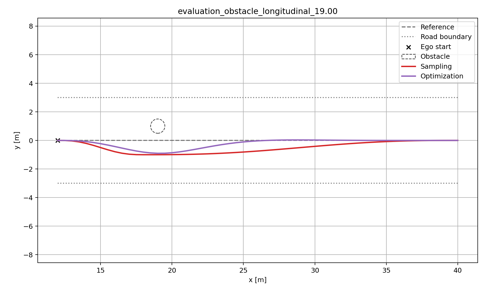
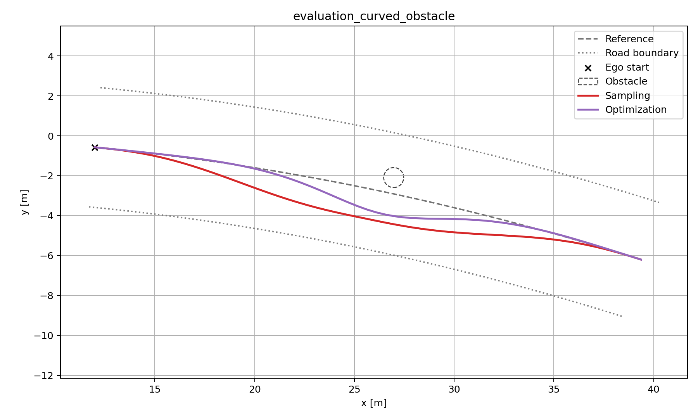

# Sampling vs Optimization Planner — Final Benchmark

## How to use this report

This report covers **Planning-only** formulations, feasibility, canonical path cost, geometry and runtime. For Safe Speed, Tracking Error, Steering Rate and closed-loop performance, use the separate [Planning & Control report](planning_control_benchmark.md). The 108-candidate Sampling experiment is a [separate DEVELOPMENT study](../development/sampling_trackability_study.md), not part of the frozen 45-candidate benchmark.

[Raw Planning CSV](../../outputs/planning_benchmark/final_planner_evaluation.csv) · [JSON summary](../../outputs/planning_benchmark/final_planner_evaluation_summary.json) · [evaluation code](../../scripts/planning/evaluation/run_final_planner_evaluation.py)

## 1. Objective

This benchmark compares two Frenet lateral path-planning approaches under the same fixed behavior intent:

- Sampling-based planner
- QP Optimization-based planner

Both planners solve the same high-level maneuver:

1. avoid a static obstacle when present;
2. remain within the configured drivable-road contract;
3. satisfy the same final physical acceptance checks;
4. return toward the Reference Line by the end of the planning horizon.

The benchmark focuses on the algorithmic trade-off between discrete candidate search and continuous optimization rather than Behavior Planning.

---

## 2. Why the Optimization Planner Was Redesigned

The redesign was triggered by Planning–Control consistency, not by a desire to improve benchmark scores.

While preparing planned paths for downstream MPC tracking, the common planner acceptance limit was found to be inconsistent with the vehicle steering model. The earlier benchmark used a permissive curvature limit of approximately:

$$
\kappa_{\max}=1.0\;\mathrm{m}^{-1}
$$

For the configured vehicle:

- wheelbase: $L=2.7\,\mathrm{m}$
- maximum steering angle: $\delta_{\max}=0.5\,\mathrm{rad}$

The bicycle-model steering geometry gives:

$$
\kappa_{\max}=\frac{\tan\delta_{\max}}{L}
\approx 0.202334\;\mathrm{m}^{-1}
$$

Once the benchmark and planner acceptance logic were aligned to this vehicle-derived limit, the original Optimization formulation exposed structural weaknesses in difficult close-obstacle cases.

The important diagnostic observation was that the Sampling Planner could still produce a physically acceptable path under the same vehicle limit in cases where the old Optimization formulation became infeasible or produced excessive curvature. This indicated that the scene itself was not necessarily physically impossible; the Optimization formulation was removing useful feasible solutions.

The original Optimization Planner used:

- an `l`-only optimization vector;
- finite-difference approximations for `l'`, `l''`, and `l'''`;
- initial derivative constraints imposed indirectly through early `l` samples;
- inflated rectangular Frenet obstacle corridors.

Two limitations became important:

1. finite-difference initial-state constraints could over-couple the first several lateral samples and delay useful lateral motion;
2. a rectangular Frenet corridor could not fully exploit heading-dependent vehicle-footprint clearance.

This motivated a formulation redesign rather than further objective tuning.

---

## 3. Evaluation Methodology

The project keeps development/tuning scenarios separate from the final evaluation geometry.

The same nine evaluation scenario definitions are retained across the redesign so pre- and post-redesign behavior can be compared without changing scenario geometry.

Because some evaluation cases were inspected during the diagnosis that motivated the redesign, the current nine-case set is best described as a **frozen evaluation suite** rather than a pristine unseen test set.

The post-redesign workflow was:

1. redesign the Optimization formulation;
2. validate only on development/tuning and stress scenarios;
3. freeze production planner logic;
4. rerun the fixed nine-scenario evaluation suite;
5. do not retune Sampling after observing its final `1.85 m` narrow-road failure.

Comparison protocol:

- success rate: all 9 evaluation scenarios;
- path quality: common-success scenarios only;
- smoothness: common-success scenarios only;
- clearance: common-success obstacle scenarios only;
- runtime: all 9 evaluation scenarios.

This prevents a planner with more failures from receiving an artificially favorable path-quality mean by being evaluated only on easier successful cases.

---

## 4. Planner Formulations

### 4.1 Sampling Planner

The frozen Sampling search space contains:

- bypass lateral positions: `[-2.0, -1.5, ..., 1.5, 2.0] m`
- bypass lengths: `[6, 10, 14, 18, 22] m`
- final lateral target: `l = 0`
- final slope target: `l' = 0`
- resolution: `0.5 m`

This gives:

`9 lateral positions × 5 bypass lengths = 45 candidates`

Each candidate is generated from smooth quintic-polynomial segments and then checked using the common final physical acceptance logic.

The main Sampling limitation is structural:

> If no member of the discrete candidate family lies inside the feasible region, the planner fails even when a continuous feasible path may exist between sampled candidates.

### 4.2 Redesigned Optimization Planner

The redesigned Optimization Planner uses the explicit Frenet state:

$$
x=[l_0,\dots,l_{N-1},\;l'_0,\dots,l'_{N-1},\;l''_0,\dots,l''_{N-1}]^T
$$

with piecewise-constant jerk:

$$
j_i=\frac{l''_{i+1}-l''_i}{\Delta s}
$$

and linear spatial dynamics:

$$
l'_{i+1}=l'_i+\frac{\Delta s}{2}(l''_i+l''_{i+1})
$$

$$
l_{i+1}=l_i+\Delta s\,l'_i
+\frac{\Delta s^2}{3}l''_i
+\frac{\Delta s^2}{6}l''_{i+1}
$$

The explicit state removes the need to reconstruct all derivative states indirectly from an `l`-only vector and allows the initial Frenet state to be constrained directly.

The current Optimization configuration also uses:

- vehicle-derived curvature limit: approximately `0.202334 1/m`;
- heading-aware nominal obstacle constraints;
- exact sampled-pose rotated vehicle-footprint clearance;
- numerical clearance gradients;
- trust-region sequential convex QP refinement;
- exact sampled Cartesian curvature revalidation after solving.

Sequential-refinement settings include:

- maximum iterations: `6`
- clearance numerical buffer: `0.001 m`
- trust region in `l`: `0.15 m`
- trust region in `l'`: `0.08`
- clearance-gradient epsilon: `1e-4`
- OSQP `eps_abs = eps_rel = 1e-6`

---

## 5. Sequential Convex Obstacle Handling

Exact vehicle-footprint clearance depends nonlinearly on position and heading, so it cannot be inserted directly as a plain linear QP constraint.

The planner evaluates exact sampled-pose clearance as a function of the local Frenet state:

$$
c(l,l')
$$

Numerical gradients are estimated around the current path:

$$
g_l\approx\frac{c(l+\epsilon,l')-c(l-\epsilon,l')}{2\epsilon}
$$

$$
g_{l'}\approx\frac{c(l,l'+\epsilon)-c(l,l'-\epsilon)}{2\epsilon}
$$

The local clearance constraint is then linearized:

$$
c_0+g_l(l-l_0)+g_{l'}(l'-l'_0)\ge c_{\mathrm{target}}
$$

A trust region limits each update so the linear approximation remains local. The resulting QP is solved again, reconstructed in Cartesian space, and checked with the exact sampled-pose footprint geometry.

The resulting loop is:

`nominal QP`
→ `Cartesian reconstruction`
→ `exact clearance check`
→ `numerical gradient`
→ `linearized clearance constraint`
→ `trust-region QP`
→ `exact recheck`

This preserves the efficiency and convex structure of the QP subproblems while allowing orientation-dependent obstacle geometry to influence the final solution.

---

## 6. Common Physical Acceptance Contract

Both planners are judged using the same final acceptance definitions.

### Curvature

The returned Cartesian path is checked against the vehicle-derived maximum curvature.

### Obstacle clearance

At every returned sampled pose, the rotated vehicle rectangle is checked against the circular obstacle geometry. The required clearance is strict:

$$
c > 0.5\,\mathrm{m}
$$

This is exact for the implemented rectangle-circle geometry **at returned poses**. It is not a continuous inter-knot collision guarantee.

### Road boundary

The production road-boundary validator currently uses a shared Frenet lateral-width contract:

$$
l-\frac{w}{2}\ge l_{\min},\qquad
l+\frac{w}{2}\le l_{\max}
$$

It does not enforce exact rotated-corner containment of the full vehicle footprint.

A separate development diagnostic projects rotated footprint corners to the reference spline and can flag cases where this simplified production road contract is optimistic.

Therefore the accurate project wording is:

> Exact sampled-pose obstacle-clearance and Cartesian-curvature validation, with Frenet-based road-boundary validation.

---

## 7. Development Regression After Redesign

A dedicated development-only Optimization regression script was added:

`scripts/planning/validation/validate_planner_redesign_development.py`

It does not build or execute the final evaluation scenarios.

Current development result:

- required tuning/development scenarios: `7 / 7 PASS`
- stress scenarios: `19 total`
- production-validation successes: `16`
- explicit infeasible/capability-boundary cases: `3`
- ordinary validation failures: `0`

The stress failures include an extremely early obstacle and very narrow-road cases and are treated as capability-envelope observations rather than triggers for post-hoc parameter tuning.

Near-boundary results are reported diagnostically rather than automatically tuned away.

---

## 8. Final Evaluation Success Rate

The post-redesign frozen evaluation suite contains the same nine scenario geometries as before.

| Planner | Success | Rate |
| --- | ---: | ---: |
| Sampling | 8 / 9 | 88.89% |
| Optimization | **9 / 9** | **100.00%** |

Sampling failed only:

`evaluation_road_half_width_1.85`

The recorded Sampling diagnostic for this case reports 45 total candidates with overlapping failure categories:

- curvature failures: `8`
- clearance failures: `34`
- road-boundary failures: `30`

These categories overlap and must not be added together.

The Optimization Planner succeeds on the same scenario with continuous decision freedom over the explicit Frenet state.

The result should not be interpreted as proof that continuous optimization always dominates Sampling. It demonstrates that, for this frozen candidate library, the narrow feasible region in the `1.85 m` case is not represented by any of the 45 sampled candidates.

---

## 9. Common-success Path Quality

The following metrics are averaged over the 8 scenarios successfully solved by both planners.

| Metric | Sampling | Optimization |
| --- | ---: | ---: |
| Canonical objective | 0.5125 | **0.2029** |
| Terminal lateral error [m] | **~0.0000** | 0.000831 |
| Terminal slope error | **0.00189** | 0.00696 |
| RMS lateral deviation [m] | 0.6156 | **0.3772** |
| Cartesian path length [m] | **28.129** | 28.142 |
| Mean obstacle clearance [m] | **0.6583** | 0.5005 |
| Worst obstacle clearance [m] | **0.5544** | 0.500096 |
| Mean max curvature [1/m] | **0.0772** | 0.1152 |
| RMS curvature [1/m] | **0.0338** | 0.0403 |
| RMS curvature rate [1/m²] | 0.0263 | **0.0224** |

The redesign changes the trade-off substantially relative to the original Optimization formulation.

Optimization now achieves a much lower common canonical objective and lower RMS lateral deviation while remaining inside the vehicle-derived curvature limit.

Sampling still retains advantages in terminal convergence, mean maximum curvature, RMS curvature, and obstacle-clearance margin.

The Optimization Planner often operates close to the hard obstacle-clearance boundary, so it would be misleading to describe the lower objective value as a uniformly larger safety margin.

---

## 10. Planning–Control Consistency Case Study: 19 m Obstacle

The scenario:

`evaluation_obstacle_longitudinal_19.00`

is the clearest example of why the Optimization formulation was redesigned.

### Original Optimization result

Under the earlier permissive benchmark acceptance, the old Optimization path had approximately:

- maximum Cartesian curvature: `0.654 1/m`
- minimum obstacle clearance: `1.092 m`

The path looked feasible under the old benchmark but exceeded the actual vehicle steering-derived curvature limit by a large margin.

### Sampling under the corrected vehicle limit

Sampling can produce a physically acceptable path with approximately:

- maximum curvature: `0.1522 1/m`
- minimum clearance: `0.5991 m`

Since:

$$
0.1522 < 0.202334
$$

this is strong evidence that the scenario itself is not inherently incompatible with the vehicle curvature limit.

### Redesigned Optimization result

The redesigned Optimization Planner produces approximately:

- canonical objective: `0.1711`
- maximum curvature: `0.1263 1/m`
- minimum clearance: `0.50085 m`

So the redesigned planner solves the same close-obstacle maneuver while respecting the vehicle-derived curvature acceptance limit.

The engineering lesson is more important than the numerical score:

> Connecting Planning to Control exposed a physically inconsistent benchmark assumption. Correcting that assumption revealed a formulation problem that objective tuning alone could not solve.

---

## 11. Narrow-road Case Study: 1.85 m Half-width

The original benchmark already contained:

`evaluation_road_half_width_1.85`

Before the redesign, both planners failed this scenario.

After the redesign:

- Sampling: FAIL
- Optimization: PASS

This is useful because it shows a second benefit of the explicit-state continuous formulation beyond fixing the close-obstacle curvature problem.

Sampling searches a finite candidate library. The Optimization Planner can continuously adjust `l`, `l'`, and `l''` and therefore can occupy a narrow feasible region that lies between the frozen Sampling candidates.

The Sampling candidate set is intentionally not expanded after observing this final result, because doing so would amount to tuning against the evaluation suite.

---

## 12. Computational Cost of the Physical-Consistency Redesign

The redesigned planner is more physically meaningful, but it is also materially more expensive than the original Optimization formulation.

The original frozen benchmark used the simpler `l`-only convex-corridor Optimization Planner and measured approximately:

- mean runtime: `7.602 ms`
- median runtime: `7.220 ms`
- maximum runtime: `11.087 ms`

The redesigned Optimization Planner now measures:

- mean runtime: `46.279 ms`
- median runtime: `53.753 ms`
- maximum runtime: `62.700 ms`

| Optimization version | Main formulation | Mean runtime |
| --- | --- | ---: |
| Original | `l`-only + finite differences + convex corridor | `7.602 ms` |
| Redesigned | explicit `[l,l',l'']` + exact footprint evaluation + sequential QP refinement | `46.279 ms` |

The historical mean runtime therefore increases by approximately **6.1×**.

This increase is expected from the redesigned algorithm. A difficult obstacle case can require multiple sequential QP subproblems, and each refinement cycle may include:

1. Cartesian path reconstruction;
2. exact sampled-pose vehicle-footprint clearance evaluation;
3. numerical clearance-gradient computation;
4. trust-region constraint construction;
5. another OSQP solve;
6. exact physical revalidation.

The trade-off is deliberate: the old formulation was very fast, but its simplified state and obstacle representation could accept paths inconsistent with vehicle curvature capability or remove physically useful heading-dependent solutions. The redesign spends computation to address those limitations.

Importantly, the comparison with Sampling remains favorable. Runtime over all 9 current evaluation scenarios is:

| Planner | Mean [ms] | Median [ms] | Min [ms] | Max [ms] |
| --- | ---: | ---: | ---: | ---: |
| Sampling | 190.665 | 188.397 | 181.477 | 220.490 |
| Redesigned Optimization | **46.279** | **53.753** | **12.502** | **62.700** |

So despite being roughly **6.1× slower than the original Optimization formulation**, the redesigned Optimization Planner remains approximately **4.1× faster than Sampling** on mean runtime in the current benchmark.

This is a useful engineering trade-off rather than a free improvement:

> The redesign exchanges some of the original QP's runtime advantage for physically consistent curvature handling, orientation-aware obstacle feasibility, and a larger useful feasible region.

---

## 13. Representative Curved Scenario

The frozen evaluation suite also includes an alternate curved Reference Line and a curved-reference obstacle case.

Both planners successfully solve:

- `evaluation_curved_nominal`
- `evaluation_curved_obstacle`

These scenarios verify that the benchmark is not limited to a straight reference-line geometry.

---

## 14. Final Comparison

### Sampling Planner

Strengths:

- simple and interpretable candidate-based behavior;
- smooth quintic trajectory family;
- low mean curvature metrics;
- strong terminal return behavior;
- generous obstacle-clearance margin in successful evaluation cases.

Limitations:

- high computation cost from generating and validating many candidates;
- runtime grows with candidate count;
- solution coverage depends on the discrete candidate library;
- can miss narrow feasible regions between sampled candidates.

### Redesigned Optimization Planner

Strengths:

- explicit physical Frenet state `[l, l', l'']`;
- piecewise-jerk dynamics;
- direct initial-state constraints;
- vehicle-derived curvature handling;
- heading-aware obstacle treatment;
- exact sampled-pose footprint clearance with sequential convex refinement;
- continuous decision freedom;
- 9/9 success on the current frozen evaluation suite;
- approximately 4.1× lower mean runtime than Sampling.

Limitations:

- mean runtime increased from approximately `7.6 ms` to `46.3 ms` after the physical-consistency redesign;
- sequential convex refinement increases runtime relative to the old simple QP;
- exact obstacle clearance is sampled-pose rather than continuous inter-knot checking;
- production road-boundary validation remains Frenet-width based rather than exact rotated-footprint containment;
- the internal QP still uses a local curvature proxy and relies on exact Cartesian post-validation;
- optimized paths can operate very close to the configured clearance boundary.

---

## 15. Engineering Discussion and Improvement Directions

The benchmark results support several engineering interpretations beyond the raw success-rate and runtime numbers.

### 15.1 Sampling coverage versus continuous freedom

**Observation:** Sampling fails `evaluation_road_half_width_1.85`, while the redesigned Optimization Planner succeeds.

**Interpretation:** The frozen Sampling Planner searches only 45 predefined bypass candidates. The result therefore shows a coverage limitation of this candidate family under the current acceptance contract, not a proof that sampling-based planning is fundamentally incapable of solving the scene.

**Improvement direction:** Candidate generation could become adaptive or coarse-to-fine, increasing density only near promising or constraint-active regions. Such a change should be tuned on new development cases rather than against the already-observed frozen evaluation failure.

### 15.2 Clearance margin and optimizer behavior

**Observation:** The redesigned Optimization Planner's worst successful obstacle clearance is only slightly above the strict `0.5 m` threshold.

**Interpretation:** This is consistent with constrained optimization using the feasible boundary aggressively when the objective does not explicitly reward additional clearance. A lower canonical objective therefore should not be interpreted as a larger safety margin.

**Improvement direction:** A robustness buffer or explicit clearance soft cost could be introduced, followed by a new tuning cycle that measures the trade-off among clearance margin, path quality, feasibility, and runtime.

### 15.3 Runtime cost of physical consistency

**Observation:** Mean Optimization runtime increased from approximately `7.6 ms` to `46.3 ms` after the redesign.

**Interpretation:** The physical-consistency improvements introduce repeated QP solves, Cartesian reconstruction, exact footprint checks, numerical gradients, and trust-region refinement. The redesign intentionally exchanges some runtime for a more meaningful feasible set.

**Improvement direction:** Potential optimizations include warm-starting sequential QPs, replacing numerical gradients with analytical clearance gradients, screening inactive constraints, terminating refinement once exact margins are sufficient, and applying adaptive refinement only around near-boundary regions.

### 15.4 Inconsistent geometric fidelity between obstacle and road constraints

**Observation:** Obstacle clearance uses rotated vehicle-footprint geometry, while the production road-boundary validator still uses the simpler Frenet-width contract.

**Interpretation:** The project currently uses different geometric fidelity for obstacle and road constraints. The independent rotated-corner diagnostic has already shown cases where the Frenet-width road check can be optimistic.

**Improvement direction:** Promote rotated-footprint road containment from a diagnostic to a production acceptance constraint, then rerun development regression before defining any new evaluation result.

### 15.5 Sampled-pose versus continuous collision safety

**Observation:** Exact obstacle clearance is checked at returned path poses only.

**Interpretation:** Two adjacent collision-free knots do not mathematically guarantee collision-free motion between them, especially near a tight obstacle boundary.

**Improvement direction:** Add inter-knot or swept-volume collision checking, or adaptively increase spatial resolution when clearance approaches the configured threshold.

### 15.6 Planning feasibility versus completed closed-loop evaluation

**Completed follow-up:** Both planners now feed the same curvature-aware MPC. Every valid planned path completed tracking at its own constant Safe Speed: Sampling **8/8** and Optimization **9/9** after planning success. Same-speed comparisons reveal that lower Frenet Planning Cost does not always imply lower tracking error or feedback effort.

See [Planning & Control benchmark](planning_control_benchmark.md) for metrics and interpretation. Future work includes planning constraints or costs directly reflecting design-speed steering-rate demands, robust clearance margins, precise rotated-corner road checks, and between-knot collision checks. Any changes require new DEVELOPMENT tests and a separate evaluation cycle.

---

## 16. Main Engineering Takeaway

The most important result is not simply `8/9` versus `9/9`.

The project demonstrates the following engineering process:

1. implement two planning approaches;
2. build a common benchmark and physical validator;
3. connect Planning assumptions to downstream Control/vehicle capability;
4. detect an unrealistic curvature acceptance limit;
5. use cross-planner evidence to distinguish scene infeasibility from formulation failure;
6. identify state-representation and obstacle-geometry limitations;
7. redesign the Optimization formulation rather than continuing weight tuning;
8. accept the resulting runtime increase as an explicit engineering trade-off;
9. validate on development/stress scenarios;
10. rerun a frozen evaluation suite without retuning Sampling on its observed final failure;
11. preserve remaining limitations as explicit improvement items rather than hiding them.

The central lesson is:

> A mathematically feasible planner output is not automatically a physically trackable vehicle path. Planning constraints must remain consistent with downstream Control and vehicle capability, and improving that consistency can require measurable trade-offs in computation, robustness margin, and model complexity.

---

## 17. Reproducibility Artifacts

Final evaluation runner:

`scripts/planning/evaluation/run_final_planner_evaluation.py`

Development-only redesign regression:

`scripts/planning/validation/validate_planner_redesign_development.py`

Raw final metrics:

`outputs/planning_benchmark/final_planner_evaluation.csv`

Machine-readable final summary:

`outputs/planning_benchmark/final_planner_evaluation_summary.json`

Evaluation source provenance:

`outputs/planning_benchmark/source_provenance.json`

Scenario figures:

`outputs/planning_benchmark/figures/`

Archived pre-rerun figures:

`outputs/planning_benchmark/previous_figures_2e0bc59/`

Evaluation scenario definitions:

`src/benchmark/evaluation_scenario_suite.py`

Planner configuration:

`src/config/planning.py`