# Development — Figure Gallery

Diagnostic and early-stage visualization figures. These are **development artifacts**, not frozen final benchmark results. Every image in the subfolders is displayed below.

## Baseline Planning & Control

### Normal-driving summary

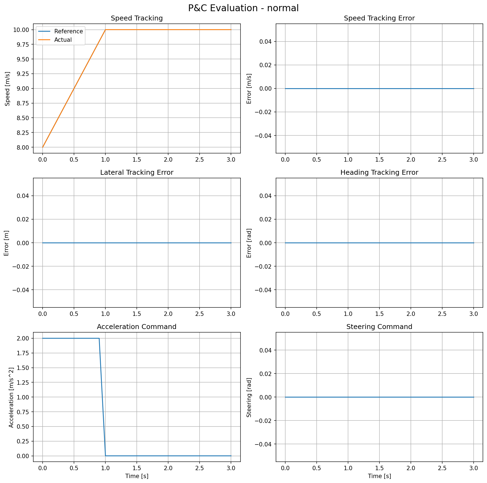

### Slowdown summary

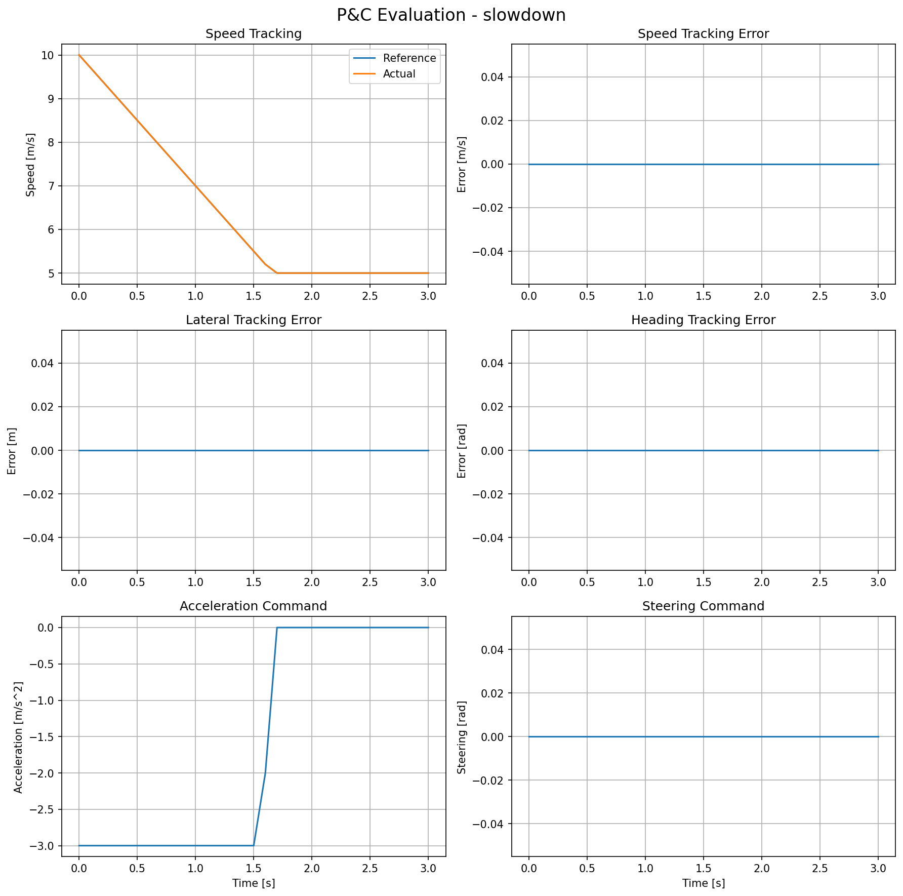

### Stop summary

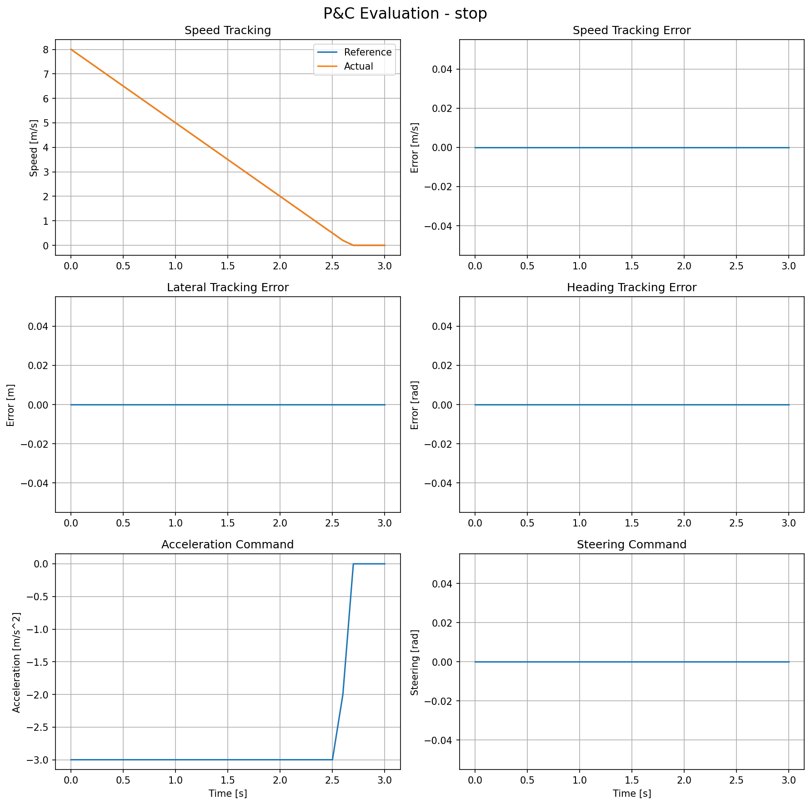

## Sampling Planner

### Sampling candidates

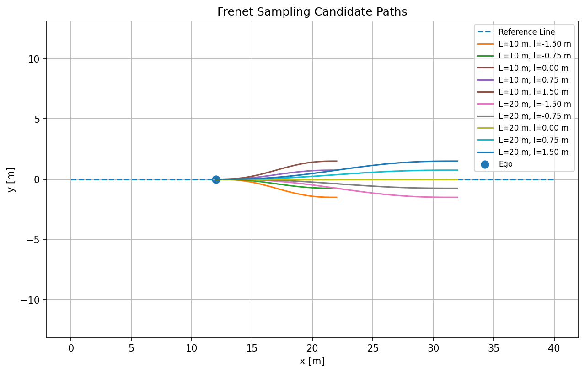

### Lateral maneuver

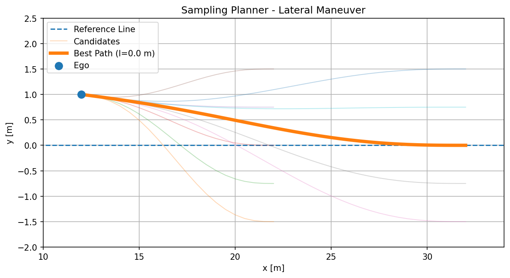

### Obstacle avoidance

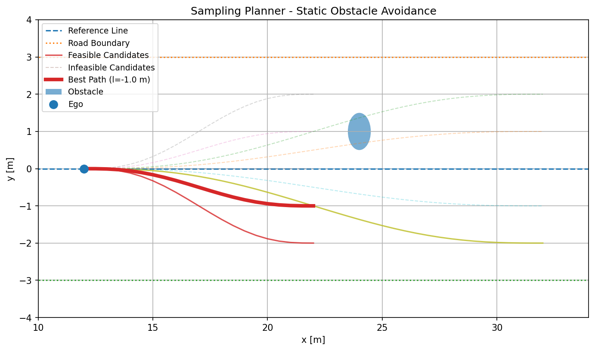

### Returning after an obstacle

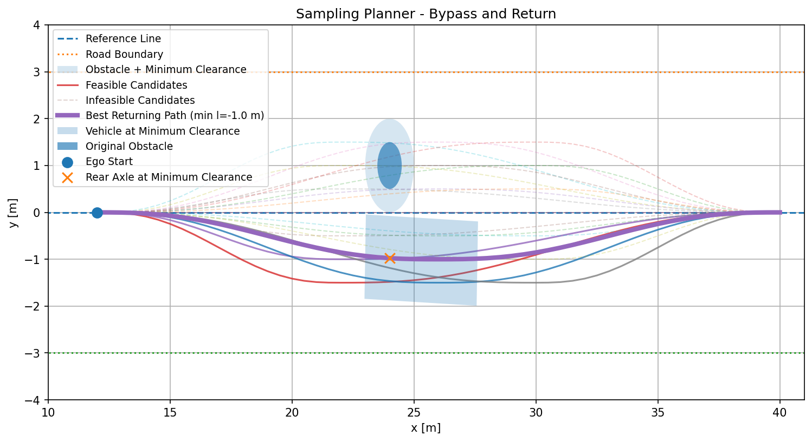

## Optimization Planner

### Corridor in Cartesian coordinates

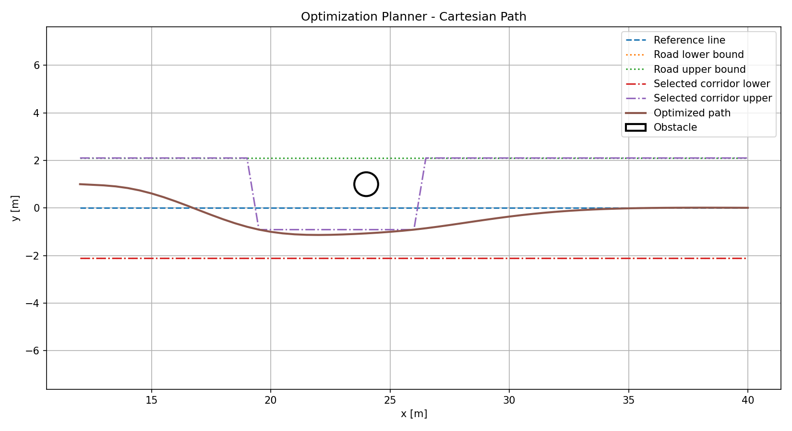

### Corridor in Frenet coordinates

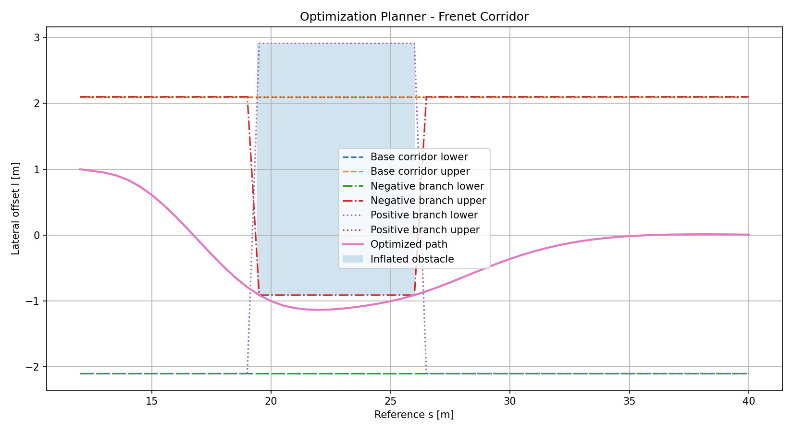

## MPC Control

### MPC 5 m/s inspection

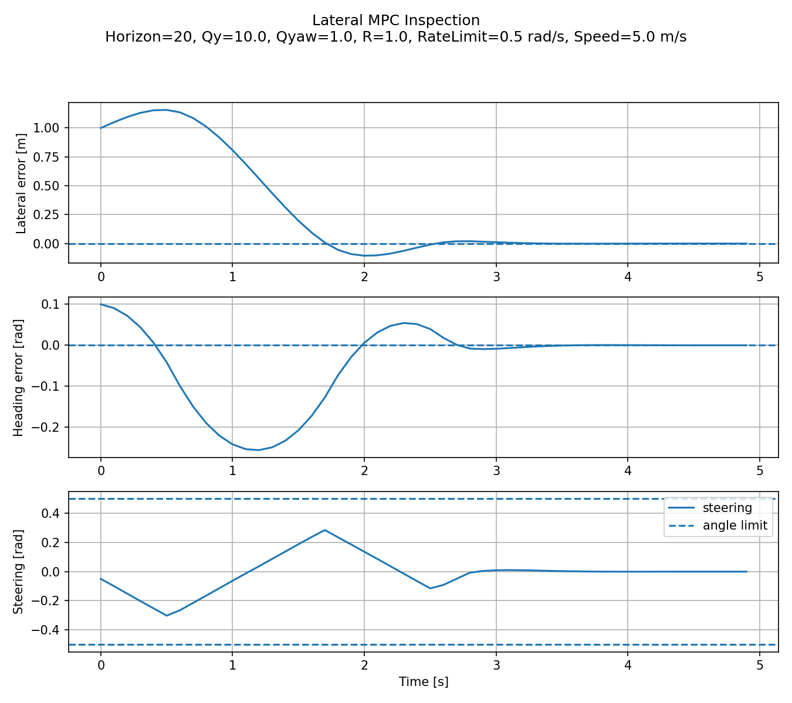

## Canonical Benchmark Diagnostics

### Canonical benchmark in Cartesian coordinates

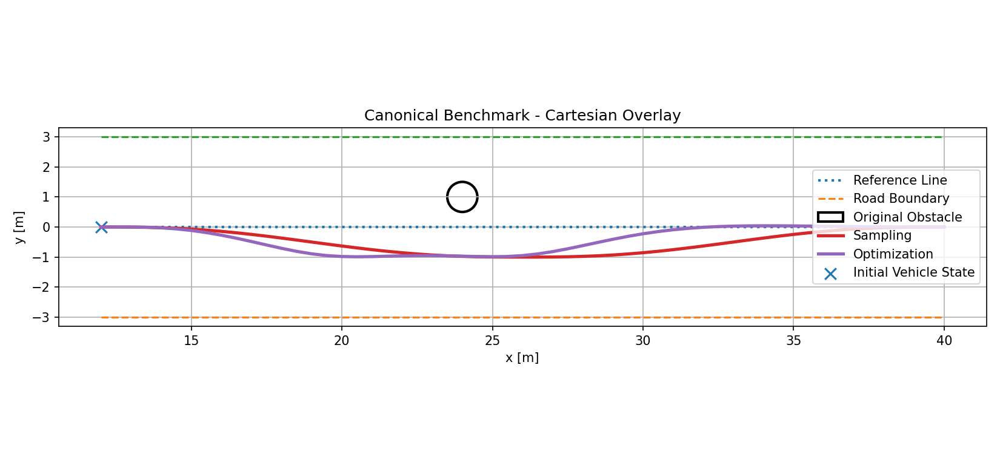

### Canonical benchmark in Frenet coordinates

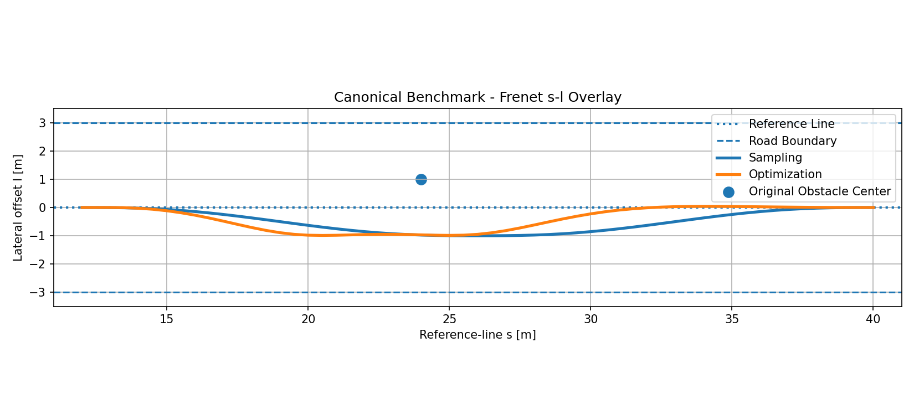
