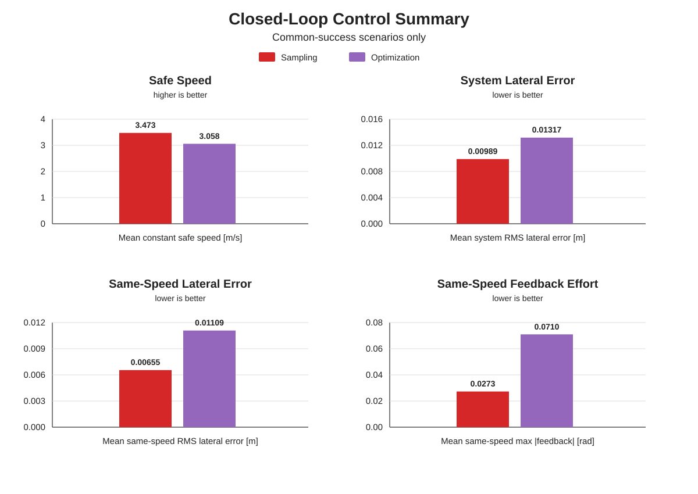
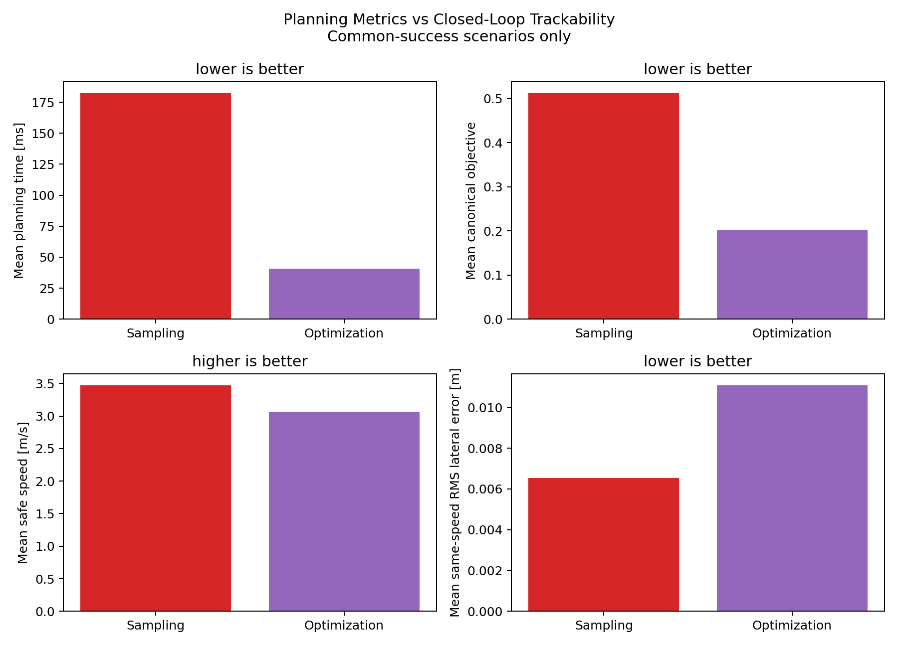
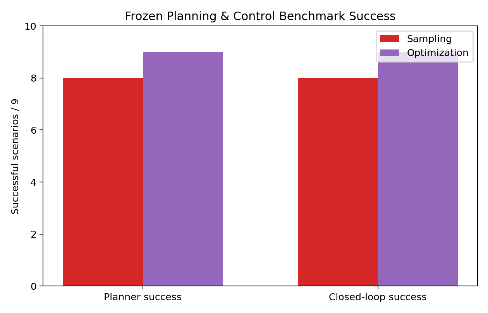
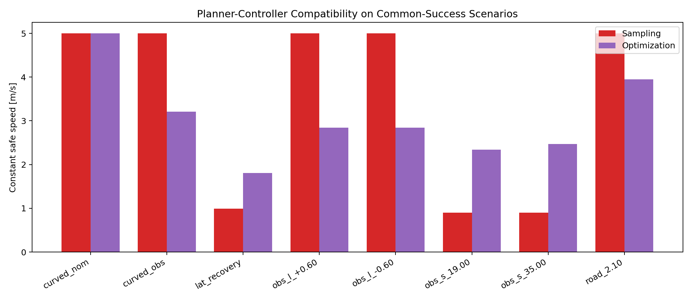
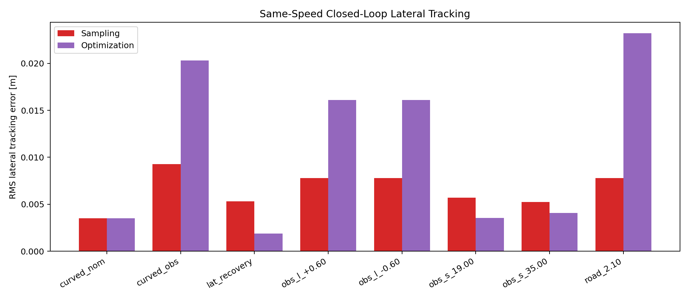
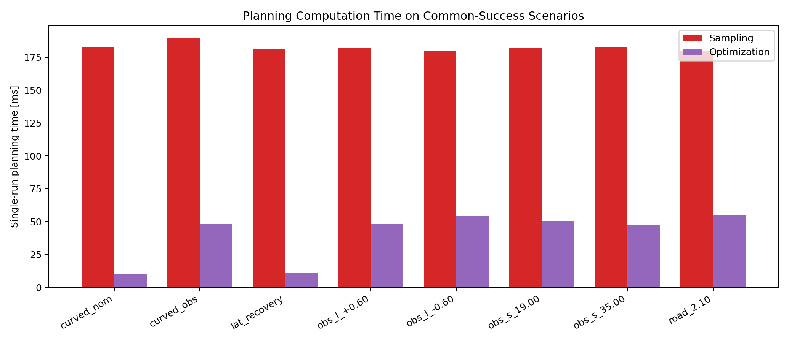

# Planning & Control Benchmark — Figure Gallery

Closed-loop evaluation of both planned paths under the same curvature-aware MPC. All figures are displayed below.

**Data:** [Per-scenario CSV](final_planning_control_benchmark.csv) · [Summary JSON](final_planning_control_benchmark_summary.json)  
**Report:** [Planning & Control benchmark](../../docs/reports/planning_control_benchmark.md)

### Closed-loop control summary

### Planning–Control bridge

### Planning and closed-loop success counts

### Safe Speed by scenario

### Same-speed lateral RMS error by scenario

### Planning time by scenario

